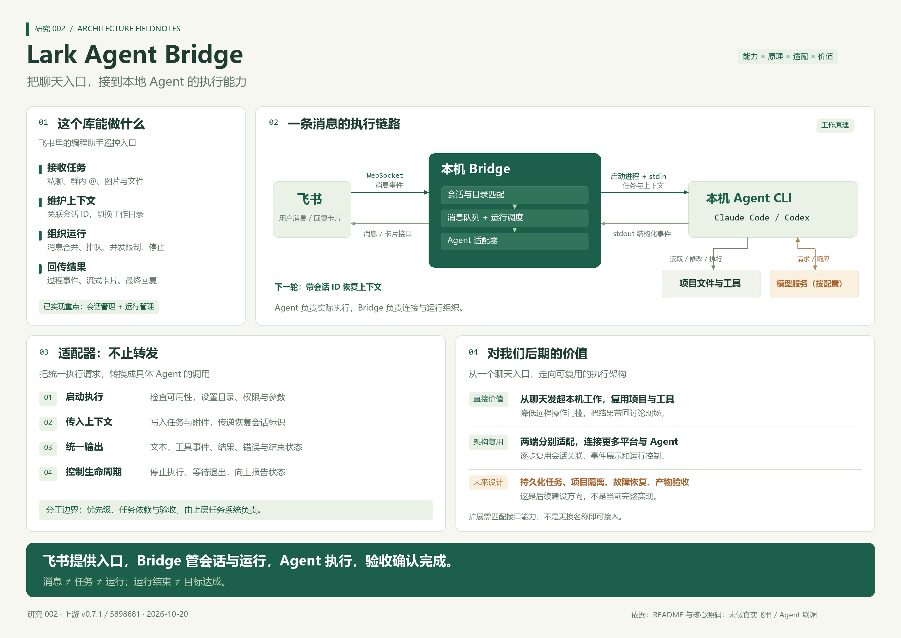
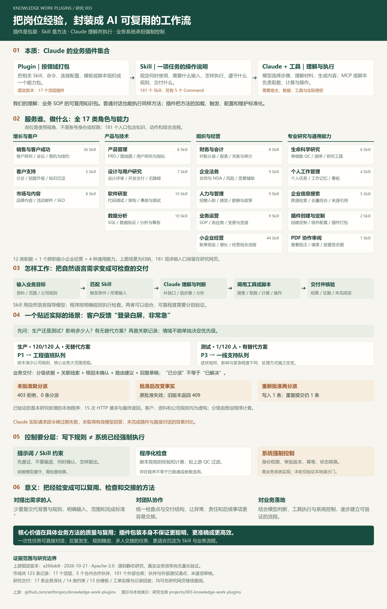
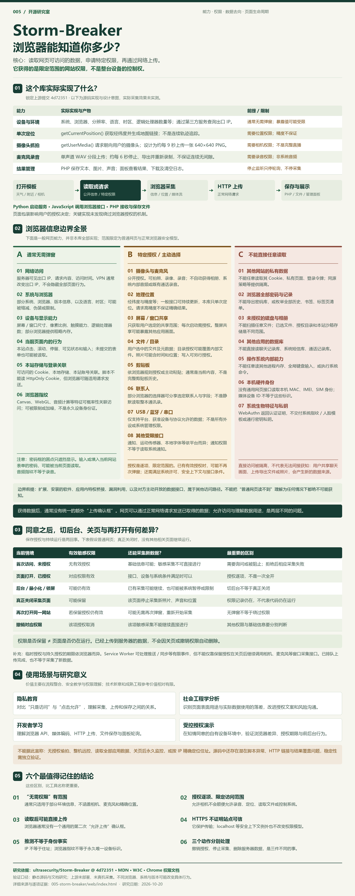
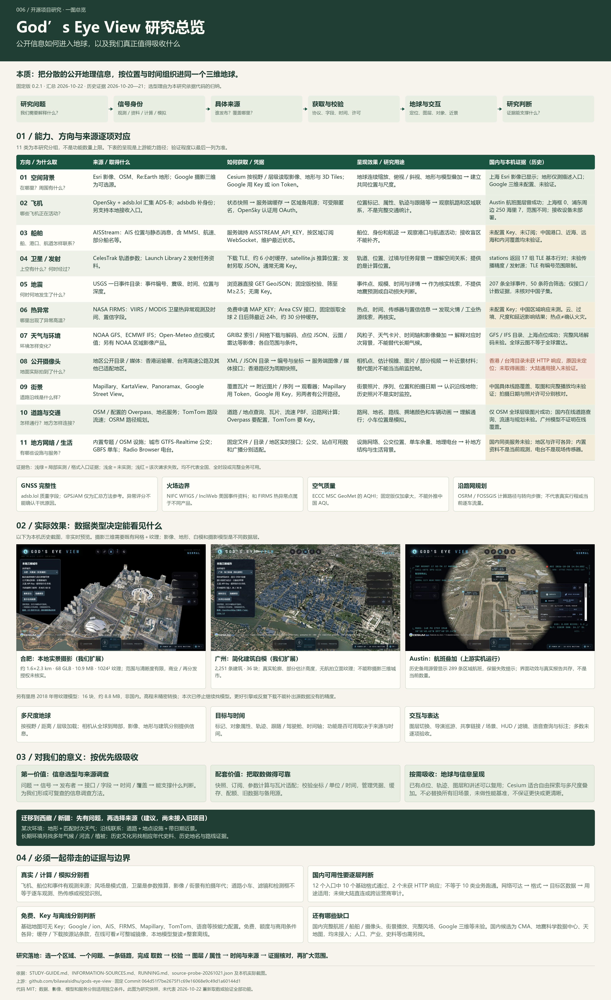
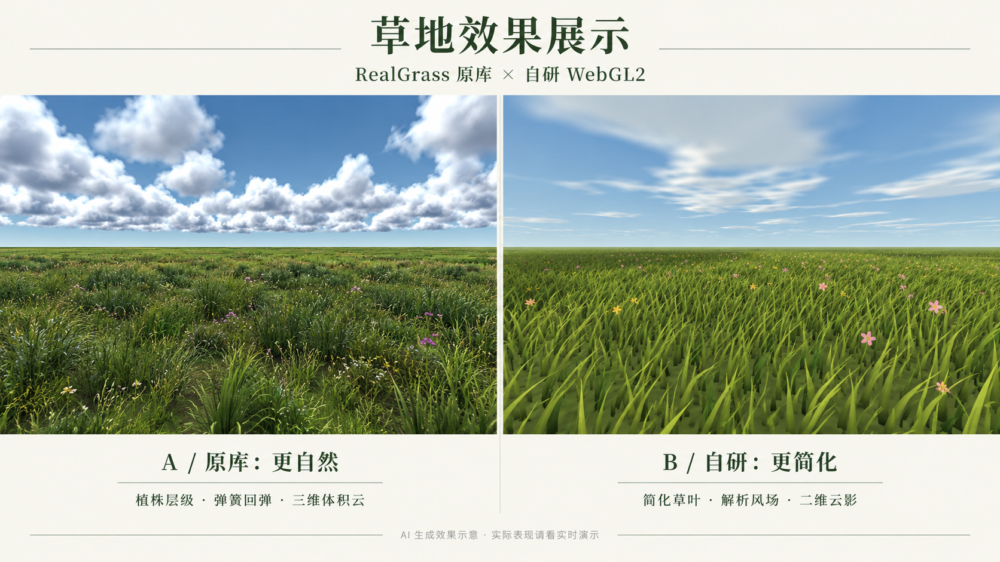

# GitHub 项目研究室

记录值得研究的 GitHub 项目与技术实践：从发现、理解，到运行、改造和总结。

这里是研究总仓库。每个子项目使用稳定编号，独立保存研究笔记、实践代码、截图和可选的 Web 演示；本页负责索引和引导。

## 项目索引

按编号升序排列。编号一经分配便保留，归档后也不重复使用。

<!-- PROJECT_INDEX:START -->
| 编号 | 项目 | 研究摘要 | 状态 | 原仓库 | 演示 |
| --- | --- | --- | --- | --- | --- |
| 002 | [Lark Agent Bridge 原理研究](projects/002-lark-agent-bridge/README.md) | 把飞书消息接入本地 Claude Code / Codex，通过适配器调用 Agent 的命令行、会话恢复与结构化输出，管理会话、排队和运行，为多平台、多 Agent 接入及后续任务系统提供基础。 | 已完成 | [GitHub](https://github.com/zarazhangrui/lark-coding-agent-bridge) | [打开](https://yydshly.github.io/1021_codex_project/projects/002-lark-agent-bridge/) |
| 003 | [Knowledge Work Plugins：Claude 岗位插件与业务 Skill](projects/003-knowledge-work-plugins/README.md) | Claude 的插件与 Skill 集合，按岗位和业务场景匹配调用工作方法；供我们复用业务 SOP，设计需求、异常处理与验收，系统权限和审批另行实现。 | 已完成 | [GitHub](https://github.com/anthropics/knowledge-work-plugins) | [打开](https://yydshly.github.io/1021_codex_project/projects/003-knowledge-work-plugins/) |
| 005 | [Storm-Breaker 浏览器权限研究](projects/005-storm-breaker/README.md) | 用原创信息图与交互网页梳理环境信息、定位、相机抓拍、分段录音和结果管理，解释 22 项浏览器权限边界、关页差异与研究价值。 | 已完成 | [GitHub](https://github.com/ultrasecurity/Storm-Breaker) | [打开](https://yydshly.github.io/1021_codex_project/projects/005-storm-breaker/) |
| 006 | [God’s Eye View：公开信息与三维地球研究](projects/006-gods-eye-view/README.md) | 汇集航班、船舶、卫星、天气、事件与公开影像，以接口取数、参数推算和 Cesium 按需加载呈现三维地球；结合实机效果与国内限制，提炼信息选型、来源接入和空间表达方法。 | 已完成 | [GitHub](https://github.com/bilawalsidhu/gods-eye-view) | [打开](https://yydshly.github.io/1021_codex_project/projects/006-gods-eye-view/) |
| 007 | [RealGrass 草地效果展示与对比](projects/007-realgrass-lab/README.md) | 一个可交互的草地效果展示：对比 RealGrass 原库与自研 WebGL2 草地，解释自然感、运动与云层的差异，并提供技术原理和实现路线分析。 | 已完成 | [GitHub](https://github.com/SamG-Coder/RealGrass) | [打开](https://yydshly.github.io/1021_codex_project/projects/007-realgrass-lab/) |

### 002 · Lark Agent Bridge 原理研究

把飞书消息接入本地 Claude Code / Codex，通过适配器调用 Agent 的命令行、会话恢复与结构化输出，管理会话、排队和运行，为多平台、多 Agent 接入及后续任务系统提供基础。

[](projects/002-lark-agent-bridge/README.md)

### 003 · Knowledge Work Plugins：Claude 岗位插件与业务 Skill

Claude 的插件与 Skill 集合，按岗位和业务场景匹配调用工作方法；供我们复用业务 SOP，设计需求、异常处理与验收，系统权限和审批另行实现。

[](projects/003-knowledge-work-plugins/README.md)

### 005 · Storm-Breaker 浏览器权限研究

用原创信息图与交互网页梳理环境信息、定位、相机抓拍、分段录音和结果管理，解释 22 项浏览器权限边界、关页差异与研究价值。

[](projects/005-storm-breaker/README.md)

### 006 · God’s Eye View：公开信息与三维地球研究

汇集航班、船舶、卫星、天气、事件与公开影像，以接口取数、参数推算和 Cesium 按需加载呈现三维地球；结合实机效果与国内限制，提炼信息选型、来源接入和空间表达方法。

[](projects/006-gods-eye-view/README.md)

### 007 · RealGrass 草地效果展示与对比

一个可交互的草地效果展示：对比 RealGrass 原库与自研 WebGL2 草地，解释自然感、运动与云层的差异，并提供技术原理和实现路线分析。

[](projects/007-realgrass-lab/README.md)
<!-- PROJECT_INDEX:END -->

## 从这里开始

- **浏览研究**：从上方索引进入子项目，查看原项目介绍、研究结论和运行方式。
- **新增研究**：阅读 [项目维护指南](docs/project-guide.md)，复制 [研究模板](templates/project/README.md)。
- **发布演示**：阅读 [GitHub Pages 部署指南](docs/deployment.md)，为每个 Web 应用分配独立路径。
- **查看图片**：每个子项目在自己的 `assets/` 目录保存截图，在研究 README 和首页索引中展示。

## 仓库结构

```text
.
├── README.md                 # 总索引与项目入口
├── projects.json             # 项目元数据，驱动首页索引和演示门户
├── projects/                 # 按 001-slug、002-slug 编号的研究项目
├── templates/project/        # 新研究项目模板
├── docs/                     # 维护规范、部署说明
├── scripts/catalog.py        # 校验索引、生成静态演示门户
├── tests/                    # 索引与发布边界检查
└── .github/workflows/        # 自动校验与手动 Pages 发布
```

## 维护命令

需要 Python 3.10 或更高版本，无第三方依赖。

```sh
# 编辑 projects.json 后，同步本页索引并生成本地静态站点
python scripts/catalog.py --update-readme

# 校验元数据、本页索引与静态站点构建
python scripts/catalog.py --check
python -m unittest discover -s tests

# 预览生成的门户；打开 http://localhost:8000
python -m http.server 8000 --directory _site
```

GitHub Pages 已启用，研究门户入口为：
[`yydshly.github.io/1021_codex_project/`](https://yydshly.github.io/1021_codex_project/)。

## 来源与授权

各研究页保留原仓库链接及其许可证说明。优先使用链接和可复现的操作说明；引入上游代码、图片或数据时，遵守原项目许可证并保留必要声明。本仓库目前未为原创内容选择统一开源许可证。
