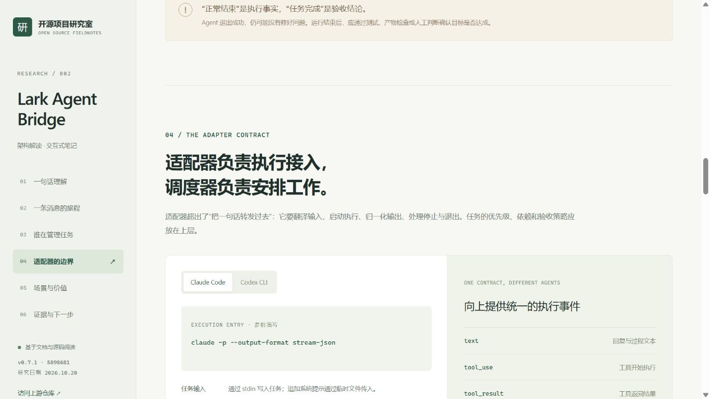

# 002 · Lark Agent Bridge：从聊天入口到本地执行

> 把飞书消息接入本地 Claude Code / Codex：适配器调用 Agent 已提供的命令行、会话恢复和结构化输出能力，Bridge 维护会话、排队与运行。对我们的价值是复用渠道接入与执行适配，为多平台、多 Agent 以及可追踪、可恢复、可验收的任务系统提供基础。

| 项目 | 内容 |
| --- | --- |
| 研究编号 | 002 |
| 上游仓库 | [zarazhangrui/lark-coding-agent-bridge](https://github.com/zarazhangrui/lark-coding-agent-bridge) |
| 上游许可证 | [MIT](https://github.com/zarazhangrui/lark-coding-agent-bridge/blob/589868119ce9a0a860aaf4936b5f9bac14e72681/LICENSE) |
| 研究版本 | `package.json` 声明 `lark-channel-bridge@0.7.1` |
| 研究 Commit | [`589868119ce9a0a860aaf4936b5f9bac14e72681`](https://github.com/zarazhangrui/lark-coding-agent-bridge/commit/589868119ce9a0a860aaf4936b5f9bac14e72681) |
| 研究日期 | 2026-10-20（Asia/Shanghai） |
| 状态 | 已完成本次文档与源码解读；真实飞书 / agent 联调未验证 |
| 网页入口 | [web/index.html](web/index.html) |
| 线上入口 | [打开研究网页](https://yydshly.github.io/1021_codex_project/projects/002-lark-agent-bridge/) |

## 研究产出

- 六节中文研究页：定位、执行链路、任务管理、适配器、场景与价值、证据与下一步。
- 六步交互流程，可查看每一步的责任层、输入输出与代码依据。
- “本库当前 / 完整任务系统”对照，明确已确认实现和进一步设计。
- Claude Code / Codex CLI 切换，解释输入、会话恢复和事件转换。
- 固定到上游 Commit 的源码链接，区分文档说明、静态代码事实和待验证结论。
- 原生 HTML/CSS/JavaScript，无第三方运行时依赖；适配桌面与窄屏。

## 核心理解

| 问题 | 研究结论 |
| --- | --- |
| 库的能力是什么？ | 在飞书接收任务与附件，维护聊天对应的 agent 会话和工作目录，安排执行并回传过程与结果。 |
| 原理是什么？ | 飞书事件经网络接口进入 Bridge；适配器启动本机 CLI，通过 stdin 输入任务、stdout 接收 JSON 事件，再更新飞书消息或卡片。 |
| 本质是什么？ | 适配器配合 Agent 对外提供的程序化执行能力，统一调用与生命周期管理；Agent 自身负责模型与工具执行。 |
| 对我们的意义是什么？ | 近期复用本机工具和项目形成聊天工作入口；架构上复用渠道与执行器适配；后续补齐独立任务、恢复和验收机制。 |

飞书提供消息、长连接与卡片能力；Bridge 维护会话关联、工作目录、消息排队和运行控制；本机 agent 负责调用模型与工具、读取文件、修改代码和执行命令。

适配器不仅转发文本，还承担一次执行的生命周期：检查可用性、组装参数、启动进程、写入任务、归一化输出，以及停止和等待退出。

“任务管理”需要限定范围：本库已阅读的核心路径主要是**会话与运行管理**。运行正常结束，不代表目标已经验收通过；内存消息队列也不能等同于持久化任务系统。

消息、任务、运行、会话是不同对象。三条补充消息可以属于同一个任务，任务可以有多次运行，会话则提供连续的上下文。独立任务记录、依赖与优先级、跨进程恢复、项目互斥和验收，是进一步设计方向。

## 预览

### 一图总结

用一张图汇总项目能力、执行链路、适配器职责与后续价值。当前实现与未来任务系统建设方向分别标注。

[下载高清 PNG](assets/understanding-map.png) · [可编辑 SVG](assets/understanding-map.svg) · [绘图源码](app/generate_infographic.py)


### 网页预览

截图位于 `assets/`，由本研究网页的本地浏览器预览生成，展示的是研究页，**不是上游产品实测截图**。



## 本地运行研究网页

从总仓库根目录运行，Python 3.10+，不需要安装前端依赖：

```powershell
python projects/002-lark-agent-bridge/app/build.py
python -m http.server 8022 --bind 127.0.0.1 --directory projects/002-lark-agent-bridge/web
```

访问 [本机预览](http://127.0.0.1:8022/)。

也可以直接打开 `web/index.html`。资源均为相对路径，无远程字体、分析脚本、模型请求或机器人凭据；公网仅用于用户主动打开资料链接。

修改 `app/index.html`、`app/styles.css`、`app/app.js` 后重新运行构建命令。构建脚本将源码证据链接固定到研究 Commit，并导出到 `web/`。

## 上游运行方法（仅文档复述，未在本次执行）

上游要求 Node.js >= 20.12.0、本机至少一个已安装并登录的 Claude Code / Codex CLI，以及飞书 / Lark PersonalAgent 应用。按照研究快照中的说明：

```text
npm i -g lark-channel-bridge
lark-channel-bridge run
```

首次通过扫码向导绑定应用，之后可在飞书中用 `/cd <path>` 指定项目，使用 `/status` 查看状态。后台运行方法与平台要求以固定版本的 [README](https://github.com/zarazhangrui/lark-coding-agent-bridge/blob/589868119ce9a0a860aaf4936b5f9bac14e72681/README.zh.md) 为依据。

本次没有安装上游、绑定账号、运行真实编程任务或验证上述安装命令。新 profile 的默认权限为 `full`，工作目录本身不是文件系统沙箱。

## 验证与发布

本项目的网页验证、仓库检查与边界记录见 [notes.md](notes.md)。部署沿用总仓库的 GitHub Pages 流程，参见 [部署说明](../../docs/deployment.md)。

```powershell
python scripts/catalog.py --update-readme
python -m unittest discover -s tests
python scripts/catalog.py --check
```

`web/` 是有意版本化的静态产物，包含本次生成的引导图。`_site/` 由总仓库工具生成，不提交。线上发布使用 `Deploy GitHub Pages` 工作流；研究页发布与上游桥接功能的端到端实测是不同验证范围。

## 来源与授权

- 上游作者与贡献者拥有原项目代码的权利，上游采用 MIT 许可证。
- 本子项目没有复制上游源文件、产品截图或品牌素材，内容为原创中文解读和架构示意；链接指向原始证据。
- 网页中的调用链和命令片段是解释性简写，不是实际运行日志。
- 页面样式与交互由本次研究编写，总仓库尚未为原创内容选择统一开源许可证。
- 具体参考来源、代码入口和未验证事项见 [研究记录](notes.md) 与网页“证据与下一步”。
