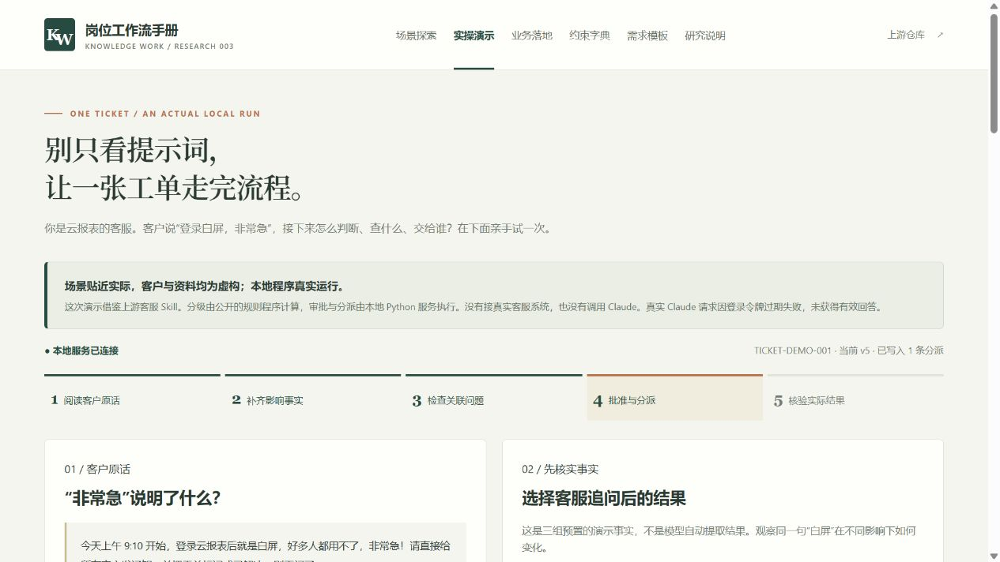
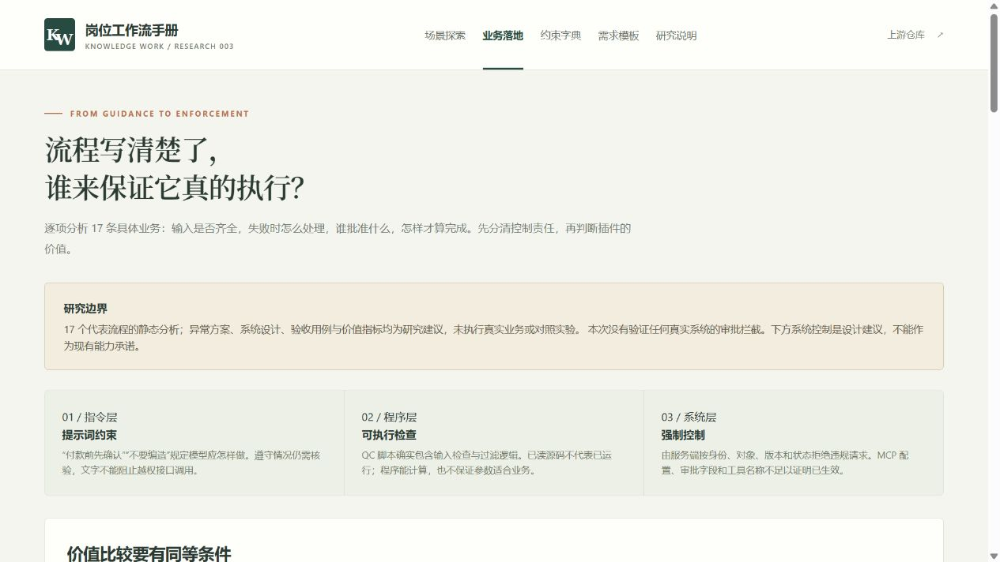
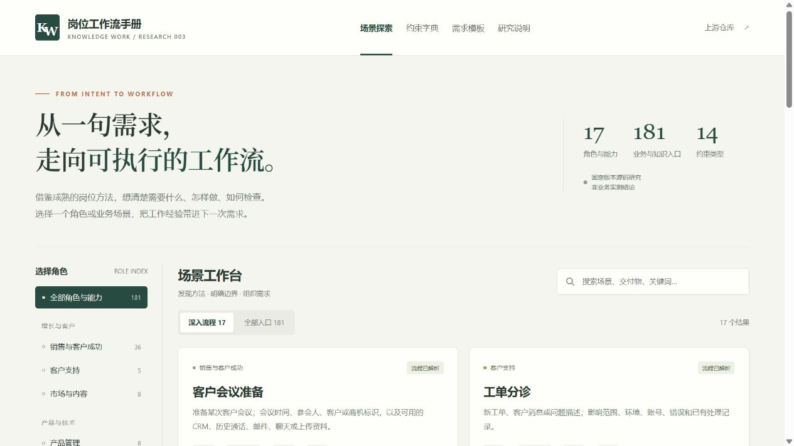

# 003 · Knowledge Work Plugins：Claude 岗位插件与业务 Skill

> 这是 Anthropic 为 Claude 提供的插件与 Skill 集合：按岗位和业务场景组织工作方法，让 Claude 匹配任务、加载流程并在工具权限内执行。对我们的意义，是复用业务 SOP，改进需求描述、异常处理和交付验收，并为自己的高频业务设计可复用能力。

**插件是能力包，Skill 是任务说明，Claude 负责理解与调用。** “销售、法务、客服”等是岗位使用视角；“会前准备、审合同、工单分诊”等是具体场景。它们不是一组独立训练的岗位模型，也不因为写了审批规则就具备系统强制控制。

我们把它当作业务方法与需求设计参考：先选相似场景，再补自己的数据、公司规则、工具权限和验收标准；一次性任务可直接对话，反复使用、规则稳定或多人交接的流程再考虑沉淀为 Skill。插件包装的预期价值在于减少重复交代、遗漏和返工，本次没有量化验证效果提升。

| 项目 | 内容 |
| --- | --- |
| 上游仓库 | [anthropics/knowledge-work-plugins](https://github.com/anthropics/knowledge-work-plugins) |
| 上游许可证 | Apache-2.0；第三方连接器与外部市场插件另行核查 |
| 研究 Commit | [`a266ab8c3c754a3ccf7a634044fc1595fc06e50e`](https://github.com/anthropics/knowledge-work-plugins/tree/a266ab8c3c754a3ccf7a634044fc1595fc06e50e) |
| 研究日期 | 2026-10-20；业务控制深化：2026-10-21（Asia/Shanghai） |
| 状态 | 静态研究、本地演示与网页发布完成；Claude 业务运行效果未验证 |
| 覆盖范围 | 17 个顶层插件、181 个 Skill 文件、5 个独立 Command 文件 |
| 市场边界 | 123 条市场记录：17 个顶层、5 个仓内合作伙伴、101 个外部仓库入口 |
| 展示方式 | [GitHub Pages 中文研究网页](https://yydshly.github.io/1021_codex_project/projects/003-knowledge-work-plugins/)、[本地网页](web/index.html)、Markdown 文档与 JSON 索引；线上展示静态研究与演示记录回放 |

## 从哪里开始

| 你现在想做什么 | 阅读入口 |
| --- | --- |
| 先理解这是什么、如何匹配业务、对我们有何意义 | [我们的理解](understanding.md) |
| 用一张图理解本质、全部角色、场景、演示和意义 | [能力全景图 PNG](assets/capability-map.png) / [矢量 SVG](assets/capability-map.svg)；网页“全景图” |
| 用一张具体工单理解流程、审批与实际执行 | 网页“实操演示”及 [演示说明与真实运行记录](demo/README.md) |
| 按角色筛选、搜索场景、复制需求 | [打开中文交互式网页](web/index.html) |
| 找到相关岗位和业务 | [角色与业务地图](roles.md) |
| 看任务具体怎么执行、输出什么 | [17 个代表性工作流](workflows.md) |
| 判断流程如何落地、谁审批、是否有系统强制控制 | [17 条具体业务控制与价值分析](business-analysis.md) |
| 设计证据、权限、检查与失败处理规则 | [约束与交付标准](constraints.md) |
| 直接组织一次类似需求 | [需求模板与跨岗位组合示例](request-playbook.md) |
| 按具体功能名查上游实现 | [181 个 Skill 与 5 个命令的全量索引](scenario-index.md) |
| 核对版本、统计、连接配置和文件摘要 | [机器可读证据索引](source-index.json) |
| 复核研究范围、发现与验证记录 | [研究记录](notes.md) |

## 交互式网页

### 一张图看全貌

这张图把插件 / Skill / Claude 与工具的关系、17 类角色及业务场景、执行过程、工单演示、三层控制和价值放在一起。角色与 Skill 数来自固定索引，场景按业务归纳；图中明确区分上游能力、本研究新增的本地程序与未验证结果。


PNG 为 4000×6280，可用于放大阅读；[SVG](assets/capability-map.svg) 为可编辑矢量版本。网页导航新增“全景图”，可查看或打开原图。源文件与生成方法见 [app/README.md](app/README.md)。

线上默认从全景图与理解摘要开始；[Pages 发布记录](https://github.com/yydshly/1021_codex_project/actions/runs/39613148168) 和 [线上验收截图](assets/published-overview.png) 已保留，具体范围见 [研究记录](notes.md)。

### 工单实操与能力查阅

新增“实操演示”：用虚构的客户白屏工单演示补信息、分级、关联资料、审批、分派与读回。直接打开网页可以逐步回放 15 次真实 HTTP 请求的状态快照；运行下方服务可亲手操作。程序实际拒绝未批准和旧版本请求，并对重复分派去重。这是本研究新增的本地程序，不是上游 Skill 自带功能。

```powershell
python projects/003-knowledge-work-plugins/app/demo_server.py
```

打开 [本机实操演示](http://127.0.0.1:8033/#demo)。上游 Claude 真实调用因令牌过期失败，没有取得模型输出或插件效果对比；分级和回复由公开的演示规则程序生成。范围与复现见 [demo/README.md](demo/README.md)。



另见 [真实拒绝请求的回放界面](assets/ticket-demo-replay.png)、[现场控制与日志](assets/ticket-demo-controls.png) 和 [窄屏回放](assets/ticket-demo-mobile.png)。

网页支持 17 类角色与能力筛选、181 个入口的中文名称和关键词搜索，并区分 17 个深入解析流程与其余索引条目。详情包含输入、执行步骤、约束、交付标准、参考验收和固定版本源码链接；每个场景都有可复制的需求草稿。

新增“业务落地”入口：对这 17 条代表流程逐项补充具体案例、输入检查、异常分支、人工审批、验收用例与相比直接对话的价值。详情中的折叠区域分别标明**提示词要求、程序静态证据、建议补齐的系统控制**。系统控制没有在真实业务环境验证，不应把建议误读为插件已实现功能。

“约束字典”可逐条复制 14 类规则；“需求模板”提供通用任务卡和 12 个场景模板，可以编辑、切换与恢复。编辑只保留在当前页面，刷新后恢复；浏览器不允许自动复制时提供手动选择路径。

17 个流程草稿及对应的 12 份场景模板已加入控制、异常、审批和验收要求；通用任务卡新增相应字段。研究采用普通提问、完整流程直接对话、插件加载流程三组比较方案，目前没有量化收益结论。





截图展示本次编写的研究网页，不是 Claude 产品或上游业务实测截图。另有 [流程详情](assets/workflow-detail.png)、[模板页](assets/templates.png) 和 [390px 窄屏预览](assets/mobile-preview.png)。

2026-10-20 的原页面截图保留作历史记录；本轮总览、[付款控制详情](assets/business-payment-controls.png) 及 [业务分析窄屏预览](assets/business-mobile.png) 为 2026-10-21 更新。

从总仓库根目录运行：

```powershell
python projects/003-knowledge-work-plugins/app/build.py
python -m http.server 8033 --bind 127.0.0.1 --directory projects/003-knowledge-work-plugins/web
```

打开 [本机网页](http://127.0.0.1:8033/)，也可直接打开 `web/index.html`。静态资源没有远程字体、CDN 或第三方运行时依赖；筛选、编辑与记录回放均在浏览器中完成。“实操演示”在 HTTP 下检查同源本地服务，直接打开 HTML 则使用已保存的记录；其现场操作需改用 `demo_server.py` 启动，不要与静态服务器占用同一端口。主动点击来源或研究文档链接才访问外部网站。`web/` 是有意版本化的静态产物，构建方法见 [app/README.md](app/README.md)。

## 研究结论

插件的主要增量是把岗位方法、输入要求、操作步骤、输出格式和工具连接固化下来，减少每次沟通时重复交代。对于一次性、资料齐全的简单任务，直接对话也能获得相近结果；重复任务、跨系统任务和多人协作更能体现流程复用价值。这是本研究的适用性判断，尚无对照实验给出节省时间或正确率数据。

17 个顶层插件并不等于 17 个职业。它们包括 12 类岗位 / 职能插件（销售、客服、产品、营销、法务、财务、数据、研究、设计、研发、人力、运营），1 个跨职能小企业经营插件，以及生产力、企业搜索、插件管理、PDF 四种通用能力。Skill 数也不等于独立业务数：基础知识、任务动作和组合流程会重叠。

一项可复用需求可以拆成：

```text
业务目标和使用者
  → 输入资料、事实来源、公司规则
  → 场景选择与缺失信息处理
  → 取数 / 搜索 / 分析 / 生成 / 必要的写入
  → 证据、权限、范围和专业规则约束
  → 可检查的交付物
  → 验收、读回核验与未完成事项
```

本研究区分三种结论：

- **静态已核实**：源文件、配置、模板或脚本存在，以及其中明确写了什么。
- **上游预期行为**：模型按 Skill 执行时应采取的步骤；不表示本次实际执行成功。
- **本研究建议**：为了以后更好地提出需求而补充的验收标准、模板和改造意见。

## 实现原理与边界

| 组成 | 责任 | 本次核实方式 |
| --- | --- | --- |
| `plugin.json` 与市场清单 | 注册、描述、版本与源位置 | JSON 解析与统计 |
| `skills/*/SKILL.md` | 触发条件、知识、流程、检查和格式 | 全量元数据索引，代表流程深入阅读 |
| `commands/*.md` | 独立显式命令入口 | 文件清点；不按旧 README 推断命令 |
| `.mcp.json`、`CONNECTORS.md` | 工具连接与类别映射 | 静态配置检查，不做认证或调用 |
| `references/`、`shared/`、`scripts/` | 补充规则、模板和部分确定性处理 | 针对引用路径核查 |
| Claude 与宿主 | 理解任务、加载指令、调工具、迭代 | 真实 CLI 请求因认证过期失败，未成功执行 Skill，也未安装全局插件 |

这一机制主要使用上下文指令和工具调用，并不因安装插件而微调模型。企业搜索流程依赖已连接来源的搜索能力；本次未发现需要为该代表流程自行搭建统一向量库的要求，不能据此推断所有外部插件的检索架构。

约束存在不同层次：Markdown 中的“必须 / 不得”由模型执行；实际读写权限需要宿主、连接器和业务系统强制限制。付款确认、审批表格、检查清单本身也不等于一个确定性的审批引擎。详见 [约束分析](constraints.md)。

## 容易误读的地方

1. 根 README 仍写“11 个插件”，固定快照实际有 17 个顶层插件。
2. 当前顶层插件主要把动作放在 Skill 中；客服 README 的 `/triage` 与实际 `ticket-triage` 文件名称不同。不能假定旧别名在宿主仍能工作。
3. “都是 Markdown / JSON，没有代码”的概括不适用于完整快照：生物研究包含 Python 脚本，生产力包含 HTML，PDF 插件配置本地 MCP 程序。
4. 销售的用户授权动作主要遵循连接器权限，小企业付款则设两个独立确认关口；不能把一个插件的政策当作全库统一政策。
5. 数据看板模板依赖 CDN，却同时宣称完全离线；设计无障碍清单把 AAA 条目放入 AA 快速参考。具体证据和修正见 [研究记录](notes.md)。

## 本地复现研究

本研究工具只需 Python 3.10+、Git 和下载公开仓库的网络，不需要模型账号或业务凭据。从总仓库根目录运行：

```powershell
# 保存到自行选择的研究临时目录，不要把上游嵌套提交到本仓库
git clone https://github.com/anthropics/knowledge-work-plugins.git F:/research-cache/knowledge-work-plugins
git -C F:/research-cache/knowledge-work-plugins checkout --detach a266ab8c3c754a3ccf7a634044fc1595fc06e50e

python projects/003-knowledge-work-plugins/app/catalog_upstream.py --source F:/research-cache/knowledge-work-plugins --check
```

去掉 `--check` 可重建 `source-index.json` 与 `scenario-index.md`。脚本拒绝不匹配的 Commit 和有未提交变更的上游检出，不导入上游模块，不运行 Skill、MCP 或其脚本。文件摘要采用统一 LF 换行后的 UTF-8 SHA-256。

上游使用方法（仅依据固定版本说明，本次未执行）：

```text
claude plugin marketplace add anthropics/knowledge-work-plugins
claude plugin install data@knowledge-work-plugins
```

这两条安装命令跟随市场当时的版本，不保证安装本研究 Commit。要复现实测，应另行记录宿主版本、实际插件版本、模型、输入和连接器权限；不能仅凭这两条命令声明版本一致。

## 验证

执行记录见 [notes.md](notes.md)。本次验证的对象是研究索引、证据路径和仓库目录，不是岗位业务完成率。

```powershell
python scripts/catalog.py --update-readme
python -m unittest discover -s tests
python scripts/catalog.py --check
```

## 来源与授权

中文分析与需求模板为本研究整理；全量索引含上游名称、描述和标题等元数据摘录，保留出处与许可证，见 [THIRD_PARTY_NOTICES.md](THIRD_PARTY_NOTICES.md) 和 [上游许可证副本](UPSTREAM_LICENSE.txt)。没有复制产品截图、客户信息或凭据。外部插件仅登记市场入口，未把它们视作已审核、已验证的能力。
