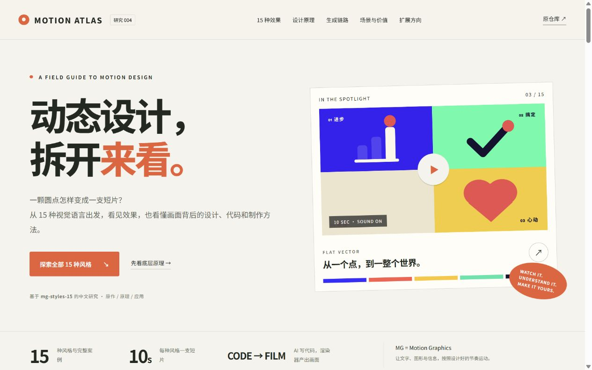

# Motion Atlas · mg-styles-15 全风格原理研究

一个可本地打开的中文交互网页：观看全部 15 支原作短片，按风格查阅设计原理、实际技术实现、价值、应用场景与可扩展方向。页面包含搜索与分类、视频详情、完整提示词复制、六个交互式运动原理实验，以及制作链路和 Remotion 的关系说明。

本质是十五套“风格提示＋制作源码＋成片参照”的创作案例：几何弹跳、手绘墨线、三维材质、形变、玻璃折射、像素冒险和HUD扫描等各有画法与节奏。可用于品牌、产品、知识和文化内容的视觉选型。其价值可进一步沉淀为风格规范、素材/动画组件与制作流程；参数模板和系列视频工具属于扩展方向，不是源库已经提供的统一生成服务。

我们对这些原理的后续实践放在 [008纸间故事：研究总结与工作台](../008-cel-story-studio/README.md)，包括独立题材、Remotion实现、原作/历史对比和 [下次制作指南](../008-cel-story-studio/NEXT-VIDEO.md)。[线上总结](https://yydshly.github.io/1021_codex_project/projects/008-cel-story-studio/#overview)与 [能力全景图](../008-cel-story-studio/assets/capability-map-019/mg-styles-capability-map.png)可直接浏览；AI编排和生成新MP4需要008的本地服务。



| 项目 | 记录 |
| --- | --- |
| 上游 | [Vincentwei1021/mg-styles-15](https://github.com/Vincentwei1021/mg-styles-15) |
| 研究版本 | `49052d80bfaf9fa8412cc9710530e5e95a3b8d8c` |
| 研究日期 | 2026-10-20 |
| 上游许可证 | MIT；原始声明保留在 `UPSTREAM-LICENSE.txt` |
| 网页入口 | [web/index.html](web/index.html) |
| 实践源码 | [app/](app/)；原生 HTML、CSS、JavaScript，无前端运行时依赖 |
| 验证记录 | [notes.md](notes.md)、[assets/verification.json](assets/verification.json) |

## 网页包含什么

- **全部 15 种效果**：逐帧手绘、等距视角、扁平矢量、线条艺术、三维渲染、形态变换、贴纸风科普、HUD、拼贴、极光玻璃、包豪斯、合成波、像素、液态、花字。每项配有本地视频、封面、设计与技术说明、应用和限制。
- **设计原理实验**：通过播放与拖动进度观察缓动、挤压拉伸、错峰、形状转场、视觉层级和音画同步的示意。示意图由本项目制作，标注为教学演示。
- **底层实现**：区分提示词、AI 编写代码、Canvas / WebGL / Three.js / Blender 渲染、帧导出、声音与 FFmpeg 合成。
- **价值与选择**：从品牌传播、产品说明、知识表达和批量内容四种场景选择风格，并解释适用条件。
- **扩展路径**：参数化模板、组件化与 Remotion 时间轴、批量渲染与质量检查。扩展内容是研究建议，不宣称上游已经实现。
- **可追溯证据**：原片、提示词和实现文件的链接固定到研究提交；提示词可完整复制。

## 运行方法

已构建网页自带字体、封面和 15 支压缩预览视频。直接打开 `web/index.html` 即可浏览；查看 GitHub 原始资料需要联网。

也可以在总仓库根目录运行：

```powershell
python projects/004-mg-styles-explorer/app/serve.py
```

然后打开 <http://127.0.0.1:8044/>。浏览期间保持服务运行，停止服务使用 `Ctrl+C`。此服务仅监听本机，并支持视频 HTTP Range 分段请求和进度跳转。服务关闭后，已经打开的网页可能仍然可见，但尚未缓存的视频将无法播放。

## 修改与重建

内容在 `app/styles.json`，页面、交互与样式分别在 `app/index.html`、`app/app.js`、`app/styles.css`。不要直接修改生成后的 `web/data.js`。

构建使用 Python 与 FontTools；素材下载和验证还需要 PATH 中的 `curl.exe`、`ffmpeg`、`ffprobe`。下载脚本针对 Windows 编写，初次运行需要访问 GitHub，下载量约 420 MB；原片缓存不提交。

```powershell
python -m pip install -r projects/004-mg-styles-explorer/app/requirements.txt
python projects/004-mg-styles-explorer/app/fetch_media.py
python projects/004-mg-styles-explorer/app/build.py
python projects/004-mg-styles-explorer/app/verify.py
python scripts/catalog.py --update-readme
python -m unittest discover -s tests
python scripts/catalog.py --check
```

`fetch_media.py` 按固定提交下载素材，支持大文件分段续传，并导出 H.264 / AAC 的网页副本。`build.py` 内嵌数据和提示词、复制封面并生成字体子集。`verify.py` 比对上游 Git blob 哈希，检查所有证据路径，并完整解码 15 支预览片。

## 研究结论与验证边界

这个仓库的核心价值是“可运行的风格案例 + 提示词 + 制作代码”，可以帮助学习视觉语言和复用制作方法。它不是统一的视频生成 API，也不等同于 Remotion 或数字人服务。不同作品使用不同渲染技术；将它们迁移为 Remotion 模板，需要重新组织时间轴、参数和资产流程。

本研究验证了公开成片、素材来源和展示网页，没有重新执行上游全部 15 套渲染工程，也没有验证其每种环境的安装兼容性。网页中的价值、场景与扩展方向是结合源码和画面做出的分析；这些建议不构成上游现成功能。

## 素材与授权

15 支作品、封面、提示词均来自上述固定提交，保留作者 Vincentwei1021 的 MIT 声明。网页视频是便于浏览的压缩副本，横版不超过 1280×720、竖版保持比例，原片链接保留在详情中；细颗粒、辉光等细节可能受到压缩影响。

字体使用 Noto Sans SC 的 OFL 授权子集，重命名为 Atlas；授权文件位于 `web/fonts/OFL.txt`。本项目未重新打包上游制作时的独立第三方素材库。继续复用上游制作源码或独立资产时，应阅读对应目录的授权说明。
