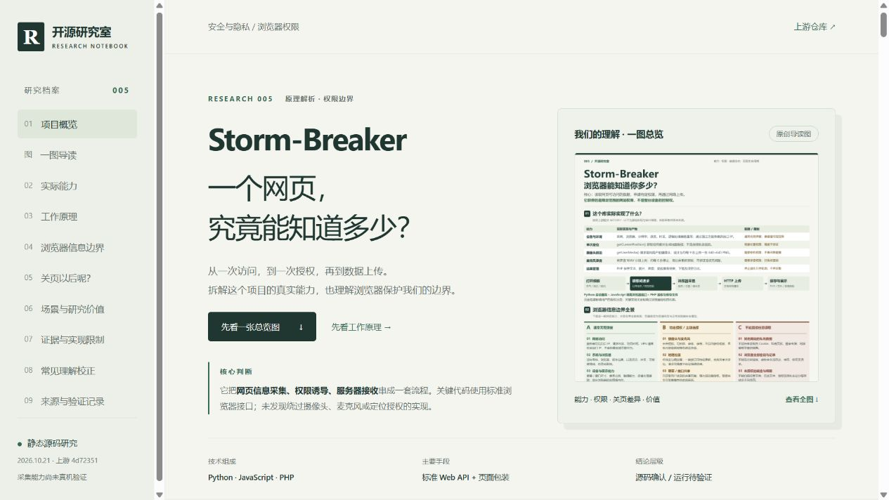

# 005 · Storm-Breaker 浏览器权限研究

以原创中文交互网页整理 Storm-Breaker 的实际能力、实现原理、浏览器信息边界、关闭页面后的行为与研究价值。

| 项目 | 内容 |
| --- | --- |
| 原仓库 | https://github.com/ultrasecurity/Storm-Breaker |
| 上游许可证 | 研究提交中未发现 LICENSE；GitHub API 未识别许可证。公开可见不代表获得任意复用许可 |
| 研究版本 | `4d7235104870ec0224f445fd905c98f22a105426` |
| 上游提交时间 | 2024-10-12 06:17:04 UTC |
| 研究日期 | 2026-10-20；整理更新 2026-10-21（Asia/Shanghai） |
| 研究状态 | 已完成（限定为静态研究与解释网页；上游运行效果未验证） |
| 网页入口 | [web/index.html](web/index.html) |
| 在线网页 | [GitHub Pages 研究页](https://yydshly.github.io/1021_codex_project/projects/005-storm-breaker/) |
| 发布方式 | GitHub Actions `Deploy GitHub Pages`，发布原创静态解释网页 |

## 一图总览

[高清 PNG 信息长图](assets/storm-breaker-overview.png) · [可缩放 SVG](assets/storm-breaker-overview.svg)

单图涵盖上游实际能力、采集链路、浏览器信息权限分类、关页前后差异、场景价值与关键误解。2400 像素宽，建议放大阅读；具体高度以实际文件为准。

图中文字为人工组织的源码与文档研究结论，由 [本地排版脚本](app/create_overview.py) 生成，未运行上游采集工具。需要 Pillow 与 Windows 微软雅黑字体。生成命令：

```powershell
python projects/005-storm-breaker/app/create_overview.py
```

## 网页预览



## 内容

- 原创完整信息图导读，支持高清打开、PNG / SVG 下载与折叠阅读。
- 概览与核心判断：标准浏览器接口、页面包装、HTTP 上传和 PHP 接收。
- 五项能力：环境信息、单次定位、相机间隔抓拍、麦克风分段录音、结果管理。
- 五阶段交互流程：访问、授权、采集、上传、保存展示。
- 22 项可筛选、可搜索的浏览器信息边界：无需弹窗、特定授权 / 主动选择、普通网页无法直接读取。
- 四种生命周期情境与有效授权开关：打开、后台、真正关闭、再次打开。
- 场景与价值判断、六项实现发现、十组问答、固定版本源码与浏览器规范来源。

## 本地运行

需要 Python 3，无第三方依赖。在总仓库根目录执行：

```powershell
python projects/005-storm-breaker/app/build.py
python -m http.server 8767 --bind 127.0.0.1 --directory projects/005-storm-breaker/web
```

打开 <http://127.0.0.1:8767/>。也可直接用浏览器打开 `web/index.html`，本页无网络数据依赖。

纳入总仓库门户：

```powershell
python scripts/catalog.py --update-readme
python -m unittest discover -s tests
python scripts/catalog.py --check
```

`app/` 是实践源码，`web/` 是有意版本化的静态产物，`assets/` 保存实际网页截图。网页适配桌面与移动设备，支持键盘操作和减少动态效果偏好。

## 核心结论

1. 敏感采集依赖网站获得的特定浏览器权限；没有发现关键实现绕过这些权限的机制。
2. “无需授权”只适用于部分环境信息。该项目未实现浏览器可以提供的全部能力。
3. 网站获准读取数据后，通常无需统一的额外“上传确认”即可发送正常网络请求。
4. 保存权限与代码继续运行是两件事。真正关闭采集页面会结束其采集；切后台不保证停止；再次访问可能使用保留授权。
5. 已上传数据不会因关页或撤销权限自动删除。
6. 学习价值主要在权限模型、社会工程学和前后端链路；技术创新与成熟工程参考价值有限。

## 验证与局限

源码阅读与浏览器规范核对已完成。网页验证结果详见 [notes.md](notes.md)。

未启动或部署 Storm-Breaker，未真实调用相机、麦克风或位置，未做跨设备采集实验、并发测试或完整安全审计。不宣称成功率、精度、兼容性或稳定性。

## 来源与授权

解释文案、页面和示意图为本研究原创，未复制上游采集工具、模板、图片或品牌素材。上游引用均链接固定 Commit；浏览器参考资料链接 MDN、W3C、WICG、Mozilla 与 Chrome 官方说明。依赖行为可能随浏览器版本变化，具体平台效果仍需独立验证。
