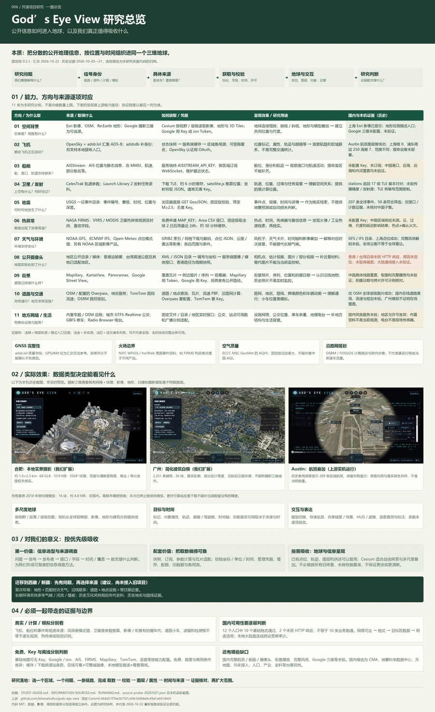

# 006 · God’s Eye View：公开信息与三维地球研究

**God’s Eye View 汇集航班、船舶、卫星、天气、事件与公开影像，通过接口取数、参数推算和 Cesium 按需加载，将信息呈现在可浏览、可跟踪的三维地球上。** 摄影城市效果由接入模型的几何、纹理和覆盖决定，战术风格由界面与着色器呈现；各层信息分别可能是观测、资料、计算或模拟。

我们的研究围绕 **能力 → 效果 → 原理 → 支持方向 → 来源与获取 → 国内限制 → 研究价值** 展开。最重要的收获是信息选型与来源调查：先明确问题，再确认所需信号、发布者、接口、时间和覆盖；随后按场景复用取数适配、缓存与降级、三维地球和空间表达。现有点位、轨迹、图层与讲述能力可以复用；西藏／新疆迁移方案尚未实施。

| 项目 | 内容 |
| --- | --- |
| 上游仓库 | [bilawalsidhu/gods-eye-view](https://github.com/bilawalsidhu/gods-eye-view) |
| 研究版本 | 0.2.1 / `064d51f7be2675f1c69e16068e9c49d1a60144d1` |
| 上游代码许可 | MIT；各数据源、影像、模型另有条款 |
| 整理与发布准备 | 2026-10-22，Asia/Shanghai；实机与接口证据为 2026-10-20—21 |
| 状态 | 来源与获取路径已整理；国内可用性按实测范围分别记录 |
| 阅读入口 | [信息采集研究与来源详表](INFORMATION-SOURCES.md) · [实测记录](notes.md) · [运行与模型附录](RUNNING.md) |

## 一图总览（2026-10-22）

[](assets/research-overview-20261022.png)

汇总能力与方向、具体信息源、获取方式、呈现效果、国内证据与对我们的价值，含 11 类来源、补充专题和 3 张历史实机截图。[查看高清图](assets/research-overview-20261022.png) · [查看矢量图](assets/research-overview-20261022.svg)。汇总时间不等于重新取数；验证证据仍为 2026-10-20—21。

总览图由 `app/overview-content.json` 与已有研究材料生成，PNG 宽 3600 像素；图内文字可在 SVG 中放大阅读。它没有替代来源详表中的全部接口、授权与运行说明。

## 研究网页

发布入口：[God’s Eye View 研究网页](https://yydshly.github.io/1021_codex_project/projects/006-gods-eye-view/)。该地址对应 GitHub Pages 的静态研究页；原地球应用需要从完整研究仓库在本机单独启动。

已整理为[完整研究网页](web/index.html)，主页面直接展示我们的理解、能力与使用场景、6 张可切换的实机效果、真实与模拟的区别、地球加载与旧项目比较、信息采集设计、11 类可搜索/筛选/展开的来源、12 个入口的实测、免费与 API Key、本地缓存、价值、常见疑问及进展缺口。详细内容另有 8 个文档阅读页。页面读取已保存的研究快照，不自动请求第三方数据源。

[理解、效果与使用取舍](STUDY-GUIDE.md)汇总了讨论形成的判断，并明确标注上游能力、本机证据和未验证项；它与来源详表一起生成网页主要内容。

补充了按问题选用来源的矩阵、国内候选调查入口与从接口到页面的验收链路；候选尚未接入。长页可通过随页章节选择器和整页搜索定位，搜索包括折叠的来源与问答。

本次[网页与完整性复核](REVIEW.md)保留 3 条阅读路径的截图、修正和剩余缺口。


本机预览地址：[http://localhost:8766/](http://localhost:8766/)。服务关闭后，在仓库根目录执行下面命令，再打开该地址：

```powershell
python -m http.server 8766 --bind 127.0.0.1 --directory projects/006-gods-eye-view/web
```

网页由研究文档生成，构建方式见 [web/README.md](web/README.md)。原地球应用与研究页独立，实机应用的启动方法仍见 [RUNNING.md](RUNNING.md)。

## 为什么选择这些信息

从源码与数据源结构可以归纳出一套选取思路：先建立一个地方的空间背景，再看移动目标、环境变化与现场影像；优先选择能定位、带时间、可通过接口持续取得的信号。**这是本研究的归纳，不是作者公开解释过的完整选型过程。**

| 需要认识什么 | 为什么采集 | 对应来源与信息 |
| --- | --- | --- |
| 地方在哪里、有什么 | 为其他资料提供位置和尺度 | Esri 影像、OSM 道路/地点、Re:Earth 地形 |
| 哪些对象正在移动 | 认识交通活动和空间联系 | OpenSky / adsb.lol 飞机状态；AISStream 船舶消息 |
| 上空有哪些轨道对象 | 认识轨道位置与过境 | CelesTrak 轨道参数，由程序推算位置 |
| 自然条件怎样变化 | 给观察和事件提供环境背景 | NOAA / ECMWF 风场预报、Open-Meteo 点位天气、部分云图和雷达 |
| 哪些地方发生了事件 | 找到需要核实的时间与地点 | USGS 地震、NASA FIRMS 热异常 |
| 地面实际拍到了什么 | 提供有来源、有日期的近景材料 | 已公开的摄像头快照及 Mapillary、KartaView、Panoramax 等街景 |
| 地方之间如何连接 | 认识道路、设施和服务网络 | OSM、内置专题数据、部分城市公交与单车接口 |

这些类别可扩展。迁移到西藏、新疆研究时，先选问题，再决定需要哪些信号，不必照搬所有图层。字段、接口、凭据和来源选择理由见[来源详表](INFORMATION-SOURCES.md#source-details)。

## 怎么获取：四种主要方式

| 方式 | 上游实例 | 可以复用的做法 |
| --- | --- | --- |
| 按时间或区域取快照 | 飞机 JSON、地震 GeoJSON、FIRMS CSV | 限定范围，校验格式和时间，再更新记录 |
| 订阅持续消息 | AISStream WebSocket | 服务端保管 Key、按区域订阅、处理断线和过期 |
| 下载参数后计算 | CelesTrak TLE + satellite.js | 保存参数历元，区分计算位置与实际观测 |
| 获取瓦片、网格、目录或固定数据 | 地图瓦片、气象 GRIB2、摄像头 XML、设施数据 | 按需读取、解析索引、保留来源与数据日期 |

上游已经实现部分代理、缓存、刷新、备用源和状态标记。新增来源仍需按格式适配；数据是否可靠、足以回答什么问题，要在采集阶段判断。[获取链路与源码索引](INFORMATION-SOURCES.md#acquisition)。

## 国内可用性：网络、覆盖和使用条件分别判断

2026-10-21 01:53（北京时间），在当前机器与配置下，对 12 个公开入口各执行一次无凭据、限时、限大小请求：**10 个通过格式检查，2 个未取得 HTTP 响应**。这是有限探测，未做跨运营商测试或网络出口审计。未见代理环境变量，不等于已证明大陆直连。

| 信息 | 当前证据 | 能支持的判断与限制 |
| --- | --- | --- |
| 地图/地形 | Esri 元数据、OSM 全球层级瓦片、Re:Earth 描述文件成功；此前上海影像实机显示 | 本机能取入口；不证明全国各层级完整加载 |
| 飞机 | OpenSky 上海框 0 条；adsb.lol 浦东周边 250 海里 7 条 | 两次查询范围不同；7 条不是上海或中国大陆完整航班数量 |
| 船舶 | 未配置 AISStream Key，未实测订阅 | 中国港口、近海与远海覆盖均未验证 |
| 卫星 | CelesTrak `stations` 返回 17 组 TLE | 该组参数可下载；不代表全量卫星或推算精度 |
| 地震 | USGS 一日目录 207 条；库的 M≥2.5 条件可留 50 条 | 是全球目录，未核对中国子集与完整性 |
| 天气 | 上海 Open-Meteo 点位返回；GFS 桶目录与 ECMWF 目录成功 | 未验证完整风场下载解码；模式值不等于本站实测 |
| 摄像头 | 源码有香港/台湾目录；本次两目录请求均失败 | 未验证画面；没有取得大陆通用公开来源 |
| 热异常、街景、路况等 | 未配置凭据或未做本次实测 | 依据源码与官方说明整理，逐来源核实 |

请求、时间、格式和错误摘要见 [source-probe-20261021.json](assets/source-probe-20261021.json)；[国内限制与判定方法](INFORMATION-SOURCES.md#china)区分了文档存在、网络可达、数据可用、区域覆盖及用途适用。

## 对我们的研究有什么价值

应沉淀的是：**研究问题 → 信息类别 → 信息产生机制 → 具体来源 → 获取方法 → 覆盖、时间与限制**。对已有点位、轨迹、图层和讲述能力的项目，基础展示可以复用；主要新增收获是找到实际入口，理解何时适合使用它。

研究西藏、新疆的环境差异，可优先调查地形、风场、降水和地点资料；研究交通联系，再调查道路、航班或沿线设施。某次天气只能解释相应时次，长期气候和历史事件要另找匹配年代的资料。此为迁移建议，尚未接入旧项目。

## 实践与历史证据

- [RUNNING.md](RUNNING.md)：固定版本启动方法、航班/上海底图截图，以及合肥、广州、里昂模型实践。
- [app/LOCAL-DATA.md](app/LOCAL-DATA.md)：模型来源、准备脚本和许可边界；本次不继续模型研究。
- [notes.md](notes.md)：历次实机记录与本次来源复核方法。
- [app/probe-public-sources.py](app/probe-public-sources.py)：有限公开入口探测，不保存凭据或完整数据流。

复跑会产生新请求，另存结果以保留历史证据：

```powershell
python -X utf8 projects/006-gods-eye-view/app/probe-public-sources.py --output projects/006-gods-eye-view/app/.logs/source-probe-latest.json
```

代码许可不替代数据许可。免费试用、无需 Key、允许长期缓存、允许公开再分发与允许商用分别判断，并在实际使用前复核服务方当前条款。
