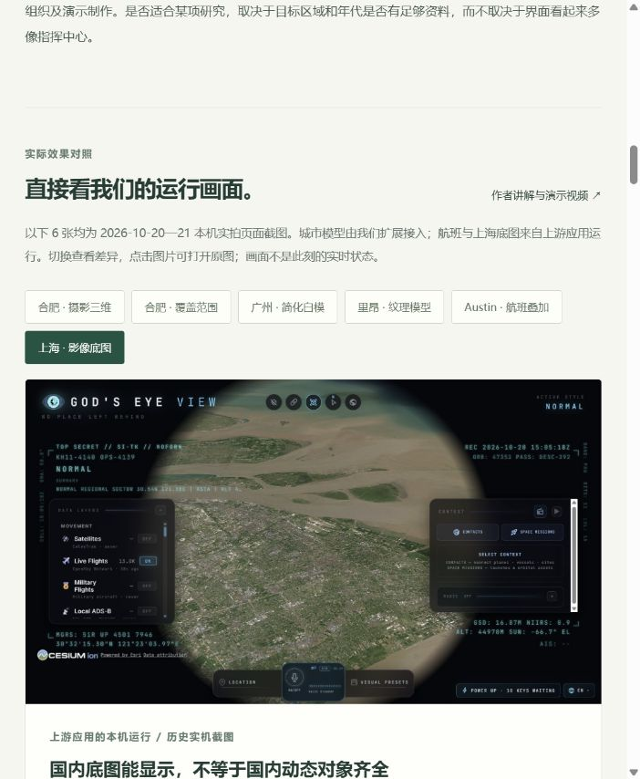
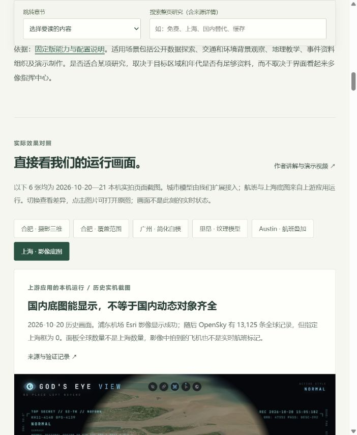
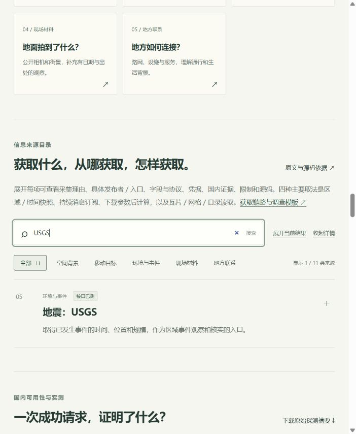
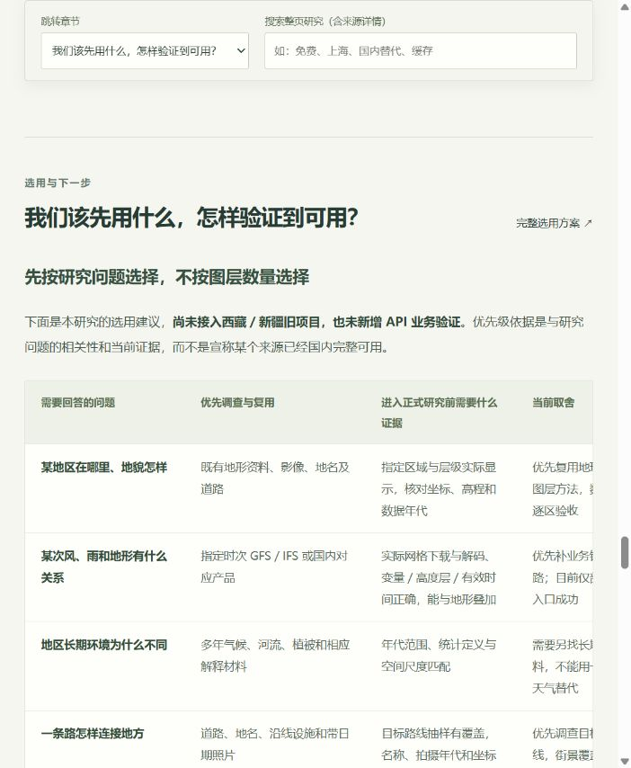

# 网页与研究完整性复核 · 2026-10-21

复核目标：检查网页是否既能说明项目与实际效果，也能帮助我们选择信息来源、理解证据和决定下一步。范围是当前研究网页、固定版研究材料及本次补充的官方网页调查；没有继续模型研究、申请 Key 或新增数据业务验证。

结论：已有研究主线较完整，主要缺口是**选用决策不够具体、国内替代入口未整理、接入验收缺少完整链路，以及长页定位困难**。这些内容和可直接修正的阅读问题已补齐。国内覆盖和未跑通业务仍是验证缺口，不能靠补文字宣称完成。

## 1. 效果对照：已完善说明位置

本次先捕获当前页面。截图、切换按钮与历史身份说明都存在；较窄窗口中，原图下方的时间、范围与限制容易落到屏幕外，读者可能只看图就作判断。

已将每张截图的身份、时间、结论和限制移到图前，图片保留原图入口。效果选择器和说明经真实浏览器复核，未用旧截图充当本次网页审查证据。

## 2. 来源查找：原查询可用，已增加整页定位

USGS 来源搜索原先正常，可得到 1 / 11 类；但只查来源目录，不能查免费条件、问答或其他章节。目录在长页顶部，中途切换阅读任务需要返回很远。

已增加随页阅读栏，包含章节选择与整页静态搜索，搜索覆盖折叠来源和问答。用空格可组合多个关键词；结果为原文片段和定位链接。验证了在原来源筛选为零结果时，用整页搜索找到 USGS，再定位会恢复全部来源并展开地震卡片。搜索不调用外部服务。

## 3. 选用计划：已补决策内容，接入验证仍待执行

新增第 10 节，把“知道有哪些来源”推进到“针对问题先调查哪些来源、拿什么证据判断可用”。包含选用矩阵、三个国内候选调查方向，以及请求、格式、空间单位、时间、覆盖、连续运行、页面和复用条件的验收链路。

国内候选是中国气象数据网／国家气象信息中心知识服务、国家地震科学数据中心、天地图开发服务。官方网页读取结果和超时分别记录，不把检索成功当作本机接口验证。地震数据中心 2026-03-26 的公告比旧流程更新，已注明原始观测及基本配置参数开放范围的变化。候选没有接入，未计入 12 项历史探测。

## 可访问性与证据范围

- 已检查原生输入、按钮、链接和章节选择器的使用；搜索结果按文本链接呈现，提供清空、空结果提示与 Escape 收起。长距离跳转改为即时定位，避免平滑滚动中途停留造成误判。
- 宽表保留可聚焦的横向滚动区域；尚未完成各设备、缩放比例、读屏器与全站对比度的系统测试，不宣称 WCAG 合规。
- 截图为本次审查的实际浏览器页面，保留于项目 `assets/review-20261021/`。本次观察窗口约 702 像素宽；不能外推为所有手机、浏览器均验收。
- 来源目录、图层与第三方服务的业务可用性按原证据理解。未重新测试飞机、AIS、相机、FIRMS、Google 三维或完整气象链路。

## 还值得继续做什么

优先选择一个具体研究问题和区域，完成一条从取数到页面、带来源与时间的链路；例如已有地形与指定时次天气的叠加。随后再决定扩大哪些来源。完整计划见[理解与使用取舍第 10 节](STUDY-GUIDE.md#10)。这份复核没有自动执行该接入。
