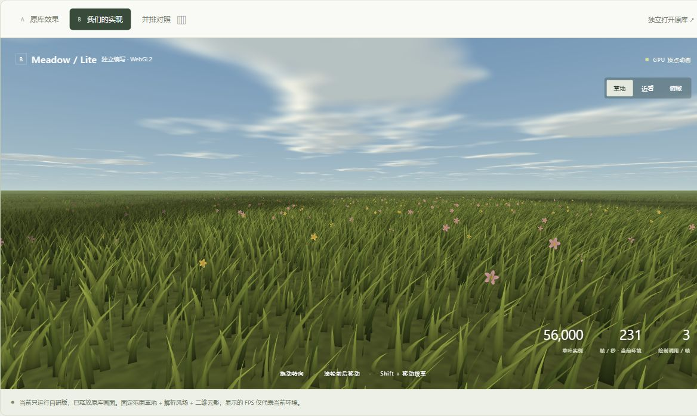

# 007 · RealGrass 草地效果展示与对比

> 一个可交互的草地效果展示：对比 RealGrass 原库与自研 WebGL2 草地，解释自然感、运动与云层的差异，并提供技术原理和实现路线分析。

| 项目 | 内容 |
| --- | --- |
| 研究编号 | 007 |
| 上游仓库 | [SamG-Coder/RealGrass](https://github.com/SamG-Coder/RealGrass) |
| 研究版本 | `f68b918796bbe3409d399e9640ca1f63164d7d26`（2026-09-21） |
| 研究日期 | 2026-10-20 |
| 上游许可证 | 此版本未发现主项目 LICENSE，GitHub API 的 license 为 null；不能把子模块 MIT 自动视为主项目授权 |
| 子模块 | cuda-webshader，固定在 `d1abd25c32b93d40ce13c7757fccdd0ce6e2f01a`，独立 MIT 许可证 |
| 本项目状态 | 已完成当前范围：网页分析、独立演示、人工对照、基础自动测试 |
| 网页入口 | [web/index.html](web/index.html)（需通过 HTTP 服务运行） |
| 远端网页 | [GitHub Pages 草地效果展示](https://yydshly.github.io/1021_codex_project/projects/007-realgrass-lab/) |
| 原库在线演示 | [samg-coder.github.io/RealGrass](https://samg-coder.github.io/RealGrass/) |

## 效果对比引导图


本图由图像模型根据两套画面的特征生成，用于引导理解；不是实测截图或性能证据。下面保留独立实现的实际运行截图，网页中可直接切换原库与自研实时效果。

## 实际运行预览



[手机尺寸预览](assets/mobile.png)。截图来自真实运行；图中的帧率是当时环境读数，不能用来推断相对性能。

## 网页的阅读顺序

1. **原库效果**：默认直接加载上游在线演示，保留独立打开和重新加载入口。
2. **我们的实现**：独立编写的 WebGL2 草地，可调风力、草高、云量、湿润配色、密度与世界种子，可暂停、切换相机与拨草。
3. **并排对照**：同页同时观察两套画面；窄屏采用上下排列。跨域原库无法自动同步相机或参数。
4. **技术原理**：交互式数据流解释生成、弹簧状态、可见性筛选和天气耦合，链接固定版本源码。
5. **价值与差异**：解释哪些复杂度有用、哪些只是视觉近似，并用表格记录能力缺口。
6. **其他路线**：Canvas / SVG、WebGL2 / Three.js、Transform Feedback、原生 WebGPU、游戏引擎与 Mesh Shader；按使用目标给出建议。

## 本地运行

环境：Python 3.10+；自研自动测试使用 Node.js 22+。运行时无 npm / CDN 依赖。

在总仓库根目录运行：

```powershell
python projects/007-realgrass-lab/app/build.py
python -m http.server 8173 --bind 127.0.0.1
```

访问 [本地网页](http://127.0.0.1:8173/projects/007-realgrass-lab/web/)。
双击 HTML 的 `file://` 方式不适用于这里的 ES modules。

原库需要网络和支持 WebGPU 的浏览器；第一次启动会编译着色器。自研版使用 WebGL2，可在原库不兼容时单独体验。默认展示的是上游当前在线页面，源码研究固定在上表的 Commit。

## 实践实现

- [app/model.js](app/model.js)：以种子和实例 ID 生成位置、形态和花朵，增加密度保留已有叶片身份；相机基底与地面拾取。
- [app/renderer.js](app/renderer.js)：原生 WebGL2、每叶 4 段几何、GPU 顶点风场、局部衰减笔刷、程序化地面和二维云影。
- [app/app.js](app/app.js)：原库 / 自研 / 并排切换、四个观察实验、原理步骤和技术路线建议。
- [app/build.py](app/build.py)：复制静态资源、生成不可变上游链接、给模块依赖和入口添加内容版本号。
- [web/](web/)：有意版本化的发布产物；没有原库源码、运行时或第三方图片。

自研版最多 3 次绘制调用：背景（含地面）、草叶、花朵。实例缓冲按实际 TypedArray 字节数显示，不包含帧缓冲、着色器和驱动开销；渲染程序不逐帧读取草叶回 CPU。

## 已知取舍

**我们对本次对照的理解：原库整体更自然。** 植株、分蘖与叶序让植物形态更有结构；逐叶弯曲和速度状态支持触碰后的持续回弹；三维体积云比自研的二维云平面更有空间厚度。自研版保留了草地氛围、基本风场与局部交互，但没有完整复现这些层次。

这里的“更符合现实”主要指视觉可信度和运动连续性。原库仍是程序化近似，没有据此验证严格的植物学、气象或物理准确性；动态差异基于实现机制与演示观察，未做动力学拟合。简单方案适合草地效果展示；自然写实、持续交互和大范围移动会让原库的额外机制更有价值。

| 维度 | RealGrass 原库（源码确认） | 本项目独立实现 |
| --- | --- | --- |
| 生成 | GPU 植物层级与器官槽位 | CPU 种子化叶片实例 |
| 运动 | 逐叶弯曲、速度、阻尼弹簧积分 | 位置与时间的解析风；无逐叶历史 |
| 拨草 | 近场持续状态 | 当前笔刷位置与统一衰减；旧位置不保留状态 |
| 天气 | 三维密度场、体积步进、云影与阵风 | 共享二维噪声云场、投影阴影与风力调制 |
| 场景 | 流式近场、分级细节、远景覆盖 | 有限场景、统一叶片细节，无流式加载 |
| 生长 | 重建成熟度 / 水分快照 | 草高与配色调整，无植物学模型 |

**未验证的结论**：自研版没有做与原库同设备、同视角、同分辨率的性能基准，不能因调用少、实例少或某次 FPS 高就宣称性能更优。其他技术路线仅作文档分析，未在本项目实现或跑分。

## 验证

```powershell
node --test projects/007-realgrass-lab/app/tests/model.test.mjs
python projects/007-realgrass-lab/app/build.py
python -m unittest discover -s tests
python scripts/catalog.py --check
```

人工浏览器验证记录、实际截图及限制见 [notes.md](notes.md)。模型测试覆盖种子恢复、密度前缀稳定、几何有效性、相机正交基底和笔刷拾取。

本轮结果：仓库 6 项 unittest、自研 4 项模型测试与 catalog 校验均通过；浏览器验证了原库嵌入、自研绘制、视图与参数切换、分析交互和窄屏布局。

## 来源与授权

源码阅读入口、官方技术文档与证据类型见 [sources.json](sources.json)。授权边界见 [THIRD_PARTY_NOTICES.md](THIRD_PARTY_NOTICES.md)。

页面文字、排版、自研渲染与交互代码为本研究独立编写。引导图为明确标识的 AI 生成效果示意，原库实际效果引用作者在线站点；未打包原库主项目源码、运行时或编译器。对 RealGrass 的概念解释不构成其代码可自由商用的授权判断。
