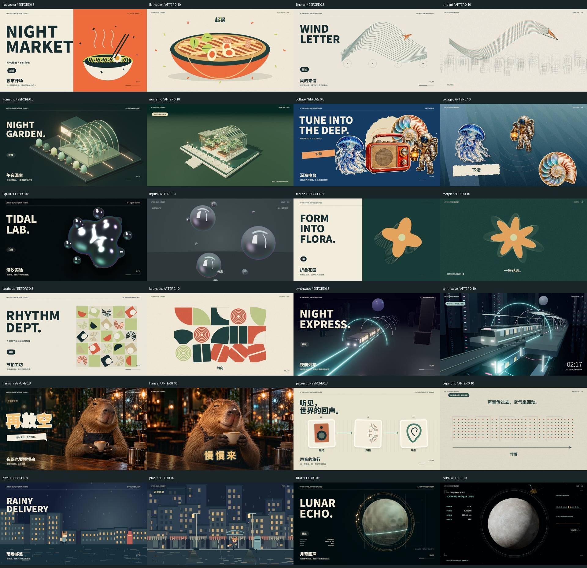

# 0.10：十二支完整影片重制（历史记录）

当前 0.11 已重做 3D 与 2.5D 的选题、分镜和运动，见 [HERO-RECRAFT-011.md](HERO-RECRAFT-011.md)；下文为 0.10 当时范围。

承接 0.9 的三维、玻璃、手绘三支影片，本轮重制其余十二支。源库仍是视觉机制与制作思路的研究来源，题材、构图、资产组合和分镜独立设计。十五项现在都提供完整十秒成片、可编辑配置与 0.8 前后对比。技术检查只能证明文件、参数与导出链路正确；审美品质需观看影片判断。

入口：[工作台放映与前后对比](http://127.0.0.1:8048/#effects-quality)；[150 秒完整连播](https://github.com/yydshly/1021_codex_project/releases/download/mg-styles-research-019/mg019-effect-examples--quality-reel.mp4)。完整连播按十五种风格顺序排列，保留各片声音，章节见 quality-reel.chapters.json。原始十五项参考仍在 reference-effects/，没有用源作成片冒充新模板。

| 风格 / 影片 | 本轮画面与分镜 | 可复用机制 |
| --- | --- | --- |
| 扁平矢量 / 夜市开场 | 热碗入场→食材落碗特写→筷子挑面→开席字版 | 分层食物插画、弹性入场、弧线与局部取景 |
| 线条 / 风的来信 | 城市线稿→风场随飞机渐进显现→邮封落版 | 密集排线、连续路径切线、描线与镜头缩放 |
| 等轴观感 / 午夜温室 | 拱架细部→植物生长→花床与步道全景→夜灯收尾 | 定制微缩模型、PBR、阴影、近景与全景运镜 |
| 拼贴 / 深海电台 | 调频特写→下潜转场→潜水员与水母→纸面标题 | 独立透明剪贴、纸边投影、定格时间、分层视差 |
| 液态 / 潮汐实验 | 球滴→分离液珠→融合连接颈→液态环重组 | GPU SDF、法线、矩形灯箱环境与地面反射 |
| 形变 / 折叠花园 | 种子→叶片与叶脉→花瓣展开→花环聚合 | 等弧长采样、循环点匹配、延迟轮廓回响 |
| 几何 / 节拍工坊 | 图形特写→120 BPM 网格编舞→四模块标志落版 | 相位错峰、四分圆、翻转、线环与逐拍声音 |
| 霓虹 / 夜航列车 | 车头近景→雨夜站台→侧面跟拍→夜航标题 | 自建列车、灯光、地面反射、相对运动与 Bloom |
| 花字 / 夜班也要慢慢来 | 倒奶→放空反应→闭眼闻香 | 同角色三张照片剪辑、逐字描边、弹性与喜剧停顿 |
| 科普 / 声音的旅行 | 扬声器振动→空气粒子往复→耳朵接收 | 纸片图解、传播相位、振膜形变、节点对应 |
| 像素 / 雨巷邮差 | 角色近景→雨巷步行→走近邮筒→投递收尾 | 320×180 真像素、精灵步态、街区视差与反光 |
| HUD / 月背回声 | 月面近景→绕月探测→扫描→锁定与回声 | 月面材料、探测器模型、纬度扫描、波形和状态编排 |

0.9 的《琥珀轨道》《最后一班月亮》《声波档案》保留原成片，制作详情仍见 [QUALITY-CRAFT.md](QUALITY-CRAFT.md)。0.8 的十五份 MP4、封面和配置保存在 web/quality-before/，供放映窗口切换比较。

## 素材与声音

照片素材使用内置 ImageGen，从本项目已有水豚角色生成两个新镜头，保存到 app/public/effects/night-cafe-v3-pour.png / night-cafe-v3-relax.png；提示词与原始路径见 [GENERATED-ASSETS-010.md](GENERATED-ASSETS-010.md)。深海素材继续复用本项目原创透明图集，未复制源库图像。

HUD 月面使用 [NASA SVS CGI Moon Kit](https://svs.gsfc.nasa.gov/4720/) 的 lroc_color_2k.jpg 与 ldem_3_8bit.jpg，署名 NASA's Scientific Visualization Studio，LROC / LOLA 数据，Ernie Wright (USRA)。[SVS 使用说明](https://svs.gsfc.nasa.gov/help/)说明未另注的内容为公开领域。这里的轨道、读数、锁定和信号均为故事示意，不能用于科研或实时观测。高程用于 bump，不声称表面真实位移解算。

十二条新配乐由 app/scripts/make-collection-scores.py 原创合成，44.1 kHz 立体声，包含调频噪声、纸片声、落料声、列车与雨的声景、像素提示音和扫描提示音等，未使用外部录音采样。生成记录在 assets/collection-scores.json。0.9 三条配乐保留。

## 复现与边界

1. app/ 下运行 npm run typecheck、npm test、npm run build。
2. python scripts/make-collection-scores.py 生成十二条声音；照片与 NASA 本地素材随项目保存。
3. node scripts/render-effects.mjs --styles=flat-vector,line-art,isometric,collage,liquid,morph,bauhaus,synthwave,hanazi,paperclip,pixel,hud --videos --variants --timeline 生成十二支整片、参数/内容对照帧与六时点审片帧。
4. python scripts/make-quality-reel.py 生成十五支完整连播；python scripts/make-effect-reel.py 生成精选。
5. python scripts/verify-effect-media.py 验证十五片媒体、解码和参数变化；本轮完整流结果另存 assets/collection-verification.json。

预览与导出共用 EffectScene：八支新 Canvas 影片由 canvas-v3.ts 路由，手绘继续使用 hand-film.ts；三项三维由 three-v3.ts 生成，液体由 liquid-film.ts 生成。三维离线材质片继续沿用 Cycles 路径。GPU 模块按需加载并释放资源，未为封面同时创建十五个 GPU 场景。放映为实际渲染成片，编辑区实时调用模板。

这些是可复用的分镜与视觉模板，标题、内容节点、配色、种子和各项参数可改；不是任意故事的全自动美术导演。液体是距离场编舞，不是流体物理；温室玻璃是实时透明近似；列车为相对运动编舞；照片花字使用静态照片剪辑；科普与 HUD 为概念示意。没有把未实现能力标成已接入。

## 本轮验片与验证结果

十二支每片六时点均人工查看，审片联系图见 assets/collection-review-1.jpg、collection-review-2.jpg、collection-review-3.jpg。修改了尾迹对齐、液体灯箱反射、月面材料、送信距离和花字语义。十五片媒体与四十五组主体变化验证通过；十二片浏览器实播无媒体错误。网页真实生成像素八秒无声版、液态六秒有声版，均与提交文字、count=14、seed=22 相符。完整技术证据见 [collection-verification.json](assets/collection-verification.json)。原故事草稿和四组件组合保留。

