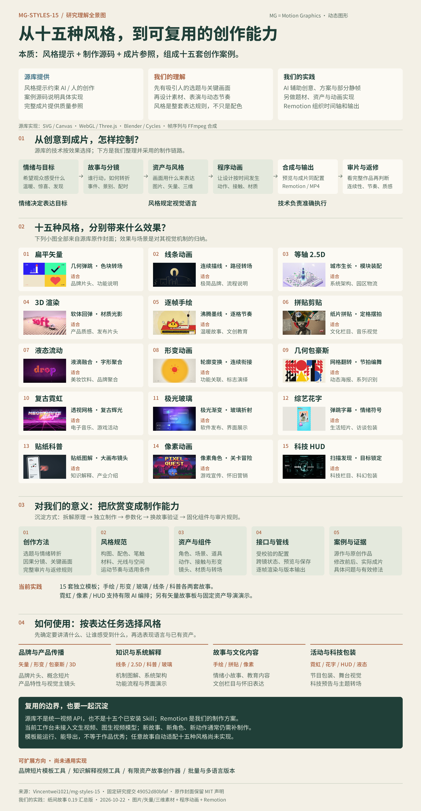

# 纸间故事 · 研究总结与创作工作台

**0.19 汇总归档版：研究收尾归档，现有演示可继续使用。** 本轮研究已经足以支持技术选型和能力判断；既有质量余项保留记录，暂不继续增加风格、作品或生成能力。影片与独立源码包保持0.18基线。

源库 `mg-styles-15` 是十五套**风格提示＋制作源码＋成片参照**，展示几何弹跳、连续描线、三维材质、沸腾墨线、形变转场、液态聚合、玻璃折射与扫描锁定等动态效果。适合为品牌传播、产品演示、知识解释、文化故事及活动包装选择视觉语言；实现技术由各个作品按需要选择。

我们的工作是研究这些原理，另做题材、资产和代码，并把它们接入可编辑工作台。核心链路为**故事与分镜设计 → 图片、矢量或三维资产 → 程序控制动画 → Remotion逐帧合成视频**。Remotion是我们的组织与输出方案，不是源库统一底座。当前没有接入文生视频、图生视频模型；AI用于创意、结构化方案及部分静帧制作，新角色、新动作和新题材仍需相应制作。

[线上研究总结](https://yydshly.github.io/1021_codex_project/projects/008-cel-story-studio/#overview) · [十五种风格与工作台](https://yydshly.github.io/1021_codex_project/projects/008-cel-story-studio/#styles) · [完整故事演示](https://yydshly.github.io/1021_codex_project/projects/008-cel-story-studio/#flagship) · [完整研究总结](RESEARCH-SUMMARY.md) · [下次制作指南](NEXT-VIDEO.md)



[打开高清全景图](assets/capability-map-019/mg-styles-capability-map.png) · [矢量版](assets/capability-map-019/mg-styles-capability-map.svg)。图中十五幅小图来自源库原作；源库能力、我们的实践和待扩展方向分别标注。

线上可看作品与原作对比、编辑预览、保存配置及下载已有作品。**AI编排与生成新MP4需要本地Node服务**；GitHub Pages只托管静态网页和现成素材。线上草稿与本地草稿按浏览器站点分别保存，继续制作时请先保存JSON再导入，不能假设自动同步。

## 现在可以使用什么

| 入口 | 已实现能力 | 使用边界 |
| --- | --- | --- |
| 故事导演演示 | 《给你一片海》及真实AI改写版，各20秒、1080p；逐镜景别、情绪、配时和字幕；保存、预览与输出 | 狐狸、小鲸与五个固定因果事件，改编范围有限 |
| 十五种独立效果模板 | 不同视觉机制与完整样片，支持文字、配色、参数及视频输出；保留原作与历次对比 | 各模板的资产和动作独立，跨风格改编需匹配相应实现 |
| 有限故事与镜头编排 | 手绘、形变、玻璃、线条、科普各两套人工设计故事；霓虹、像素、HUD支持手动及AI镜头编排 | 有限的对象、事件与镜头词表，尚未覆盖任意故事 |
| 原有故事世界 | AI生成受约束的矢量角色、场景、物件与关键帧，支持多镜编辑和互动 | 图形类型、骨骼和行为受schema与运行时约束；部分风格为二维近似 |
| 可带走的创作包 | 创作型Skill、参考规则、原创角色/场景/音轨、锁定依赖和独立Remotion工程 | 方法与示例可复用，新角色、新动作仍需设计和实现 |

可沉淀的是**导演方法、资产与动作/材质实现、数据契约和制作管线**。情绪是创作目标，风格是视觉语言，技术负责执行；应从实际作品中积累它们之间有效的连接方式。

## 下次如何做类似视频

按“**写简报 → 选风格与入口 → 定分镜和关键帧 → 复用并补做资产 → 本地制作输出 → 完整审片归档**”执行。先复制已有配置或独立工程，确认对象与动作是否在模板范围内，再决定补什么；新题材不应仅更换文字和颜色后直接视为完成。

[下次制作指南](NEXT-VIDEO.md)包含可复制简报、入口选择表、六步工作流，以及每次应留下的资产、配置和质量基准。后续可扩展为品牌短片模板、知识解释工具、有限资产故事创作器或批量/多语言生产；这些是产品方向，尚未成为通用能力。

## 先看作品，再看方法

- [《给你一片海》完整影片](web/director-examples-018/main.mp4) · [真实AI改写《给你一片星海》](web/director-examples-018/rewrite.mp4) · [关键帧与返修记录](web/production-notes-018.html)。两版验证同一资产包内的重编排，未验证任意新故事生成。
- [十五支完整作品画廊](web/index.html#effects-gallery) · [源库原作](web/reference-effects/index.html#gallery) · [十五项质量缺口](web/production-notes-016.html)。现有作品保留差异与不足，不以能运行或测试通过代表艺术达标。
- [下载完整创作能力包](web/director-kit-018.zip) · [阅读项目内Skill](skills/mg-story-director/SKILL.md) · [独立工程运行说明](web/director-kit-018/assets/demo-project/README.md)。包内无依赖目录、凭据和私人日志，未安装为全局Skill。

## 来源与研究基线

| 项目 | 记录 |
| --- | --- |
| 风格研究来源 | [Vincentwei1021/mg-styles-15](https://github.com/Vincentwei1021/mg-styles-15)，固定提交 `49052d80bfaf9fa8412cc9710530e5e95a3b8d8c` |
| 源库与本项目关系 | 研究十五组风格提示、源代码和演示，提取表达机制；本项目另做题材、角色和执行代码，保留原作对照 |
| 实现基线 | 汇总整理0.19.0；影片与独立包0.18；Remotion `4.0.537`、React `19.0.0` |
| 研究日期 | 2026-10-22 |
| 许可 | 源库代码MIT；纸纹按固定版本README的CC0/公开领域说明；Noto Sans SC为OFL；Remotion使用自身许可 |
| 完整记录 | [研究总结与边界](RESEARCH-SUMMARY.md) · [素材与技术声明](app/public/effects/CREDITS.md) · [历史笔记](notes.md) |

## 本地运行与维护

已有依赖时，可使用 [start-workbench.cmd](start-workbench.cmd)。或在总仓库根目录执行：

```powershell
cd projects/008-cel-story-studio/app
npm ci
npm run build
npm start
```

打开 <http://127.0.0.1:8048/#overview>，保持服务运行。静态 `web/` 支持浏览、手动预览与下载已有作品；AI创作和新视频输出需要Node服务。请通过HTTP访问，不直接双击HTML。

本地预览/渲染需要Node.js与兼容Chromium。可用 `CHROME_PATH` 指定浏览器；3D自定义最终导出另需Blender 4.5+，可用 `BLENDER_PATH` 指定。AI创作复用本机已登录Codex CLI，需要网络和账户可用额度；它连接远端模型服务，不是本地离线模型。可用 `CEL_CODEX_PATH` 指定CLI的绝对路径，不在项目内复制凭据。

修改网页后执行 `npm run build` 并刷新；修改影片绘制代码后还需重启服务，使渲染端重新打包。应用检查：

```powershell
npm run typecheck
npm test
```

仓库级检查在总仓库根目录运行：

```powershell
python -m unittest discover -s tests
python scripts/catalog.py --check
```

核心基线已有验证包括实际AI改写、应用与撤销、浏览器MP4输出、两支600帧影片完整解码/播放，以及独立包安装与关键帧渲染。证据见 [0.18媒体记录](assets/review-018/media.json)、[网页播放记录](assets/review-018/browser-playback.json)、[独立包证明](assets/review-018/portable-proof.json)。技术验证与美术判断分开；未完成专业主观听觉审片，JSON原生文件选择器交互也未在该轮单独验收。

0.19已复核总结首页、风格筛选、编辑入口、旧研究锚点与草稿恢复，并修复空代码分包的HTTP响应问题；41个原作、成片与能力包文件保持不变。本轮未调用AI或重新渲染影片，实际记录见 [汇总版验收](assets/review-019/verification.json)。

历次作品、原作、配置和返修档案全部保留，可从[研究总结的资料索引](RESEARCH-SUMMARY.md#资料索引)继续查阅。归档表示暂停继续研究，不表示所有风格或任意故事生成已经成熟。
