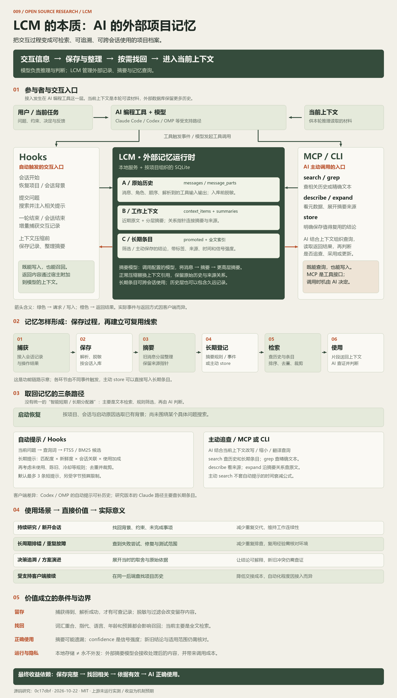
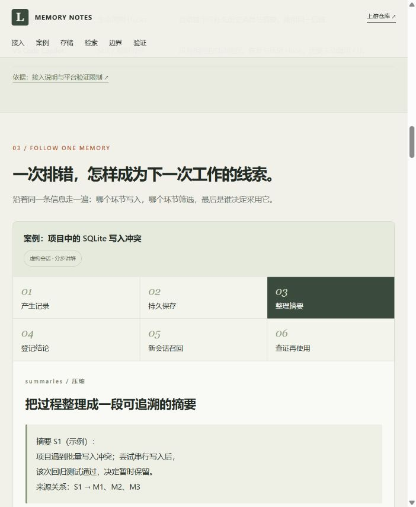

# 009 · LCM：AI 编程助手的外部项目记忆

LCM 为 AI 编程助手提供模型之外的项目记忆。它保存捕获的交互历史，整理分层摘要和长期条目，在新会话或新问题中找回相关材料，帮助助手接续项目、复用排错经验并追溯决策依据。

其原理是通过宿主 Hooks 自动触发捕获与恢复，通过 MCP / CLI 提供主动查询、展开来源和保存结论的入口；本地 SQLite 管理消息、摘要关系与长期条目，检索结果按规则和预算进入当前上下文。

适合持续研究、长周期开发、重复故障排查和方案演进记录。预期价值是减少重复交代背景与重复排查，让结论能回到原始依据核对。实际收益取决于捕获完整性、检索相关性、依据是否有效，以及 AI 是否正确使用；本研究没有运行上游验证这些收益。

| 项目 | 内容 |
| --- | --- |
| 原仓库 | https://github.com/lossless-claude/lcm |
| 上游许可证 | MIT（已核对研究提交的 LICENSE） |
| 研究版本 | `0c17dbffda452cf7fae46929af427dff355aeaa3` |
| 研究日期 | 2026-10-21；总图更新于 2026-10-22（Asia/Shanghai） |
| 状态 | 已完成，限定为源码分析与解释网页；上游运行效果未验证 |
| 网页入口 | [在线研究网页](https://yydshly.github.io/1021_codex_project/projects/009-lcm-memory/) · [本地网页](web/index.html) |
| 发布目标 | GitHub Pages；部署结果见 [notes.md](notes.md) |

## 一图理解：本质是外部项目记忆

[在线一图全解](https://yydshly.github.io/1021_codex_project/projects/009-lcm-memory/overview.html) · [本地图解网页](web/overview.html) · [高清 PNG](assets/lcm-external-memory.png) · [矢量 SVG](assets/lcm-external-memory.svg)

一张原创总图覆盖：外部记忆本质、宿主与上下文、Hooks / MCP 双向职责、三层存储、摘要模型、功能链路、三条召回路径、四类使用场景，以及价值成立的条件。网页支持完整图与五个模块视图切换，并提供文字版。



图中收益是基于机制推导的预期，不代表运行实测。原始消息与摘要、自动提示与主动查询、信号强度与事实正确率都分别说明。

## 网页内容

- 定位：外部项目档案与查询工具，和当前上下文、产品自带记忆的区别。
- 接入：Hooks 的自动触发与 MCP / CLI 的主动调用；各客户端自动化程度。
- 贯穿案例：六步解释一次排错如何被保存、摘要、登记、召回和查证，支持前后切换与来源链接。
- 存储：原始消息、工作上下文、长期条目；可展开的摘要来源关系。
- 检索：区分启动恢复、问题自动提示、AI 主动追查三条路径；提供明确对象、模糊指代、新旧冲突三种提问情境。
- 评分演示：调整年龄、使用反馈，观察示例长期记忆得分和排序变化。
- 限制与源码索引：来源保留不等于摘要无损，检索命中不等于最终回答正确。
- 验证方案：捕获完整性、跨会话召回、压缩细节、新旧冲突、成本与收益五项待实测计划，以及八个关键术语。



## 本地运行

需要 Python 3；网页没有第三方运行依赖，也不调用真实 LCM 服务。在总仓库根目录运行：

```powershell
python projects/009-lcm-memory/app/build.py
python -m http.server 8779 --bind 127.0.0.1 --directory projects/009-lcm-memory/web
```

访问 <http://127.0.0.1:8779/>。也可直接在浏览器打开 `web/index.html`，CSS、JavaScript 均使用相对路径。

如需重新绘制总图，额外需要 Pillow 与 Windows 微软雅黑字体；现有网页运行无需这些绘图依赖：

```powershell
python projects/009-lcm-memory/app/create_overview.py
python projects/009-lcm-memory/app/build.py
```

`app/create_overview.py` 同时生成 SVG 与 2400 × 4220 PNG，保存到 `assets/`；构建脚本将图片复制到 `web/media/`，确保独立网页和静态子路径可访问。

`app/src/` 保存网页源码；`app/build.py` 将固定版本源码链接展开后生成 `web/`。`assets/` 保存实际页面截图。修改页面后重新构建，不直接修改 `web/`。

## 核心理解

1. Hooks 既能保存也能召回，MCP 既能查询也能主动存储；后端负责真正的记忆管理。
2. 正常压缩替换 `context_items` 引用，保留消息和摘要来源关系。
3. `episodic` 是历史会话层，并不等于只有近期内容的“短期记忆”。
4. `promoted` 是筛选出的跨会话条目；摘要提升路径使用规则，confidence 不是事实正确率。
5. 自动提示与主动搜索是不同路径，主动搜索不套自动提示的时间衰减公式。
6. 接入端行为不同，不能假设任意 AI 客户端都能获得相同自动记忆能力。

## 验证与限制

浏览器中验证了阶段切换、记忆层切换、摘要逐层展开、评分控件与重置；实际控制台未捕获错误。仓库要求的单元测试与索引检查结果见 [notes.md](notes.md)。

评分候选与匹配分为人工设定，仅将源码中的基础评分与使用加成做成可交互示意，不构成真实召回实验。未安装或运行 LCM；未验证中文召回、捕获完整率、模型成本、任务收益、脱敏覆盖或客户端兼容性。页面含移动布局规则，本轮观察了约 702 像素宽的浏览器布局；未做手机真机兼容测试。

## 来源与授权

网页文案、样式与示意图为本研究原创；无上游图片或代码整段复制。评分演示用原创 JavaScript 表达已说明的公式。上游来源均链接固定提交，MIT 许可证可在 [上游 LICENSE](https://github.com/lossless-claude/lcm/blob/0c17dbffda452cf7fae46929af427dff355aeaa3/LICENSE) 核对。

完整研究索引、验证范围与后续问题见 [notes.md](notes.md)。
