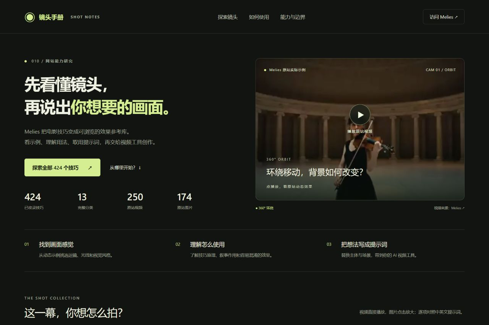
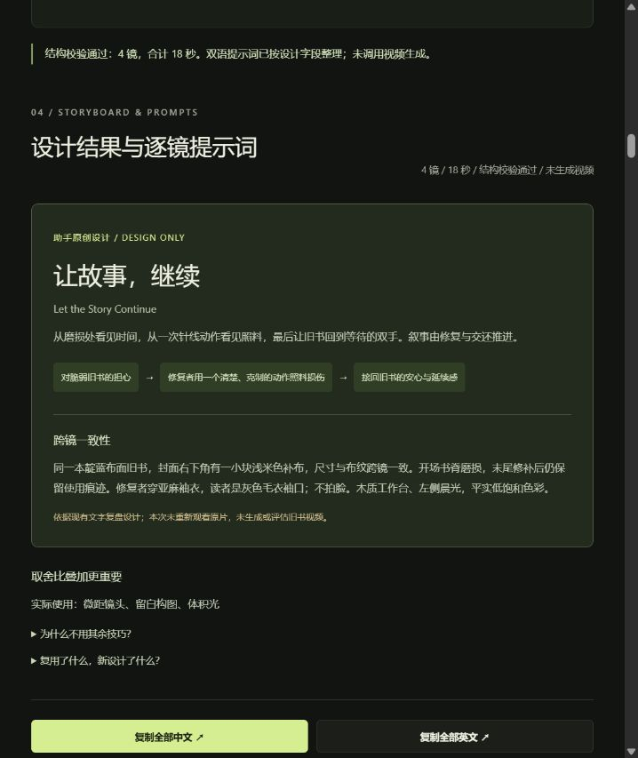

# 010 · 镜头手册：视频创作的动作素材库

这是一份**以情绪需要驱动的AI视频创作动作素材库**：用424项电影语言参考和4个实测题材，帮助模型选参考、设计情境与动作、生成分镜和双语提示词，再用实际视频复盘偏差。

| 关注点 | 我们的理解与当前边界 |
| --- | --- |
| 能力与效果 | 可直观看原站视频／图片、复制中英提示词、导入助手设计的分镜，并对照原创成片与动作问题；动作是否可信、情绪是否成立仍需审片。 |
| 可沉淀的技术 | 动作起止与接触／支撑描述、统一ID与双语案例索引、三层分镜结构、提示词交接和结构校验、输入与素材哈希、证据帧和失败反馈。当前已有数据结构、脚本与审片方法；自动物理判断和稳定生成控制尚未实现。 |
| 后期使用场景 | 可按需扩展为品牌与服务短片、产品与工艺演示、人物关系叙事，以及带检索和反馈的模型创作助手／团队经验库；这些场景尚未封装成通用工具。 |

**2026-10-22按用户要求暂时归档，后期按具体需求重启。** 现有资料、实际视频和创作工作台保留，停止主动扩库与继续生成。库以情绪需要和动作事件为核心：语言模型从参考与经验中取舍、设计分镜和双语提示词，视频模型生成，审片后把经验回库。


[网页归档总览](https://yydshly.github.io/1021_codex_project/projects/010-melies-cinematic-guide/#archive) · [问题与归因](https://yydshly.github.io/1021_codex_project/projects/010-melies-cinematic-guide/#archive-issues) · [动作汇总](https://yydshly.github.io/1021_codex_project/projects/010-melies-cinematic-guide/#archive-actions) · [机器可读归档](app/archive-summary.json) · [信息图准确生成输入](app/archive-infographic-provenance.json)

[归档页面截图](assets/archive-page.png)。构建、56项自动测试与15项目索引校验通过；网页验证总览图、五类问题、四个实际案例和16项观察正常展示，实际对照帧与案例链接可用。

现阶段沉淀四个实测题材与一次旧书两镜返修，整理16项动作／表达观察。香水：雨滴涟漪、倒影变化、产品环绕与留白；旧书：刷拭、穿针、合书与交还；陶器：触杯、端杯行走、停步与窗边停留；取车：抬眼回应、擦座垫、扶稳交接与车旁推行。观察条目不等于独立实验数，也不代表稳定成功率；原站424项含运镜、构图、光线、风格，不能称为424个已验证人物动作。

归档将问题分为参考素材不一致、约束未落实、任务与过程控制不足、情绪起点不清、验收不足。取车两镜座垫差异在静态参考中就已存在；“基本可读”只说明动作顺序可辨认，不能代替整片可信度验收。助手的输入和验收有责任，任务过密等仍是未隔离的可能因素；现阶段无法分配提示词与模型的责任百分比。后期可按需扩展动作视频参考、统一资产、模型检索编排、小样对照与观众反馈，目前均未实现。

完整汇总 Melies Cinematic Techniques 索引中的 **424 个技巧、13 类内容**：250 项展示原站主视频，174 项展示原站主图片，每项都配原站英文提示词与对应中文翻译。首批提炼 **7 项创作规则**，网页支持“输入目标 → 选技巧 → 复制给当前助手创作 → 导入分镜 → 双语提示词”，并用旧书修复新题材跑通流程。

| 项目 | 内容 |
| --- | --- |
| 研究编号 | 010 |
| 来源网站 | https://melies.co/cinematic-techniques |
| 上游仓库 | 未确认公开源码仓库；本项目为网站能力研究，不将其标注为开源库 |
| 上游许可证 | 未确认开放转载授权；视频和图片直接引用原站 CDN，未下载或再分发媒体文件，版权归原权利人 |
| 研究版本 | 2026-10-22 查阅公开索引与全部 424 个详情页，无公开版本号 / commit |
| 状态 | 已归档，按需重启；目录与工作台保留，香水16秒、旧书18秒、陶器15秒、取车20秒均实际生成，旧书另有一次两镜局部返修 |
| 静态入口 | [web/index.html](web/index.html) |
| 公开网页 | [GitHub Pages](https://yydshly.github.io/1021_codex_project/projects/010-melies-cinematic-guide/#archive) |

发布采用总仓库的GitHub Pages手动工作流，只托管已构建的 `web/`。本页提供资料展示与提示词交接，实际视频生成由外部模型完成，网页不携带生成服务凭据。门户封面、首页引导图与归档总览统一使用 `assets/research-overview.png`，保留其原图和生成记录。

整个站点容量受GitHub Pages限制，本项目40个视频／制作参考图原件由[同仓库媒体Release](https://github.com/yydshly/1021_codex_project/releases/tag/melies-media-20261022)承载，页面直接引用相同字节，不重编码视频。映射、大小和SHA-256见[发布媒体清单](app/publication-media.json)，`assets/` 中的原件与历史执行记录保留。总览图、截图证据和文字仍由Pages展示；播放及取用媒体需要联网。

## 实际页面截图



[素材与中英提示词](assets/video-gallery.png) · [双语对照详情](assets/bilingual-detail.png) · [图片详情](assets/image-detail.png) · [视频详情](assets/video-detail.png) · [手机详情](assets/mobile-detail.png) · [完整页面](assets/full-page.png)

## 内容与交互

- 完整覆盖原站 424 项、13 类，并保持原索引顺序；来源清单见 [app/source-index.json](app/source-index.json)。构建时逐项比对路径，防止遗漏、重复或错配媒介。
- 按实际主媒体决定展示视频或图片。视频点击后加载并播放；图片可打开详情放大；每项有对应原站详情链接和素材直链。
- 英文原文与中文翻译对照展示，卡片和详情都有独立的“复制中文 / 复制英文”按钮。详情复制当前编辑框的内容，不附加标签或格式；两种语言可独立编辑，不自动互译。
- 中文逐项翻译自详情页 `#prompt pre.cinematic-prompt__body`，即原站可复制的文本框，而不是其上方的技巧说明。具体场景示例保留人物、动作、参数和约束；带 `[Subject]` 的模板统一译为 `【主体】` 并支持中英文分别填写主体快捷替换。
- 原站少数可复制提示词或配图与技巧名称可能不一致；忠实保留来源并在对应条目提示核对，不以自行编写的文字或图片冒充原站内容。
- 13 类筛选、视频 / 图片筛选、技巧名、中文译文与英文原文关键词搜索、环绕 / 航拍 / 转场快捷检索，每次显示 24 项，可展开当前全部结果。
- 详情含原站素材、效果说明、中英文提示词对照、编辑与分别复制；支持键盘关闭、复制失败提示和媒体加载失败提示。
- 同时只播放一个视频，标签页进入后台暂停，关闭详情释放视频源。原站媒体直接联网加载，仓库不保存原站视频或图片；本次原创生成的素材和成片单独保存在项目内。

原站提供效果参考、技巧解释、使用建议、可复制提示词及创作工具入口。原站没有逐条公开生成过程；不能确认视频或图片由旁边的提示词生成，也不保证其他模型复现。本页不调用生成服务、不上传用户填写的主体。

## 作为模型的创作参考

模型先理解创作目标，再从库中选择相关的运动、构图、光线和剪辑规则，设计新的主题、镜头组合与提示词。网页中的“原创方案”展示本次模型完成的二次创作，不是在线调用生成模型的表单。

- 原创案例 **《把森林，带回城市》**：16 秒、4 镜的虚构香水概念片。用微距、雨景、图形匹配、弧线环绕、反射、留白和体积光，设计水纹 → 瓶盖 → 森林倒影 → 广告落版的视觉叙事。
- 每镜记录传播作用、借用规则、新增设计、主要运动、原站技巧引用、中英文原创提示词及剪辑建议。引用按钮可打开对应原站效果；原创提示词独立复制，不覆盖原站原文。
- 案例已实际生成：[16 秒成片](web/generated/rain-to-forest/rain-to-forest.mp4)。网页支持成片及四段原始生成素材分别播放、下载，并记录与设计目标的偏差。原站视频只用于解释引用技巧。
- 模型参考包：[简明能力索引](web/capability-index.json)、[完整能力记录](web/capabilities.json)、[创作指引](web/model-guide.md)、[原创分镜 JSON](web/creative-case.json)。先读取简明索引，再按候选 ID 查看详细记录，避免无差别堆叠所有技巧。
- 构建时检查案例引用 ID 均真实存在、镜头时长合计正确、中英文提示词及原创设计说明完整。模型指引要求处理来源疑点，并区分引用规则与新增内容。

[查看原创案例截图](assets/creative-case.png)。实际源码为 `app/creative-case.js`、`app/model-guide.md` 和 `app/export_knowledge.py`。

## 从规则到新创作的工作台

网页新增 `#studio`，采用用户选定的 **当前助手创作，网页复制创作包并导入分镜稿**，不接入在线文本生成 API。

1. 输入目标、主体、观众、情绪、场景、禁止项、时长、画幅与参考素材。
2. 本地关键词筛选候选，展示命中和排除提醒，手动核对。每条规则有来源、参数、条件、问题和验收标准，并可打开原站效果。没有命中时不强行选择。
3. 复制创作包给当前助手。助手围绕事件与情绪设计主题、选镜理由、跨镜一致性和中英文分镜字段，返回纯 JSON；网页不把模板当作模型输出。
4. 粘贴或导入分镜，校验当前简报、规则引用、必填参数、一个主要摄影机运动、匹配转场配对、镜数与总时长。简报、候选或输入稿改变会使旧结果失效。
5. 网页整理逐镜双语提示词，分别复制单镜或全片，下载完整 JSON 和双语 Markdown；完整 JSON 保留 `storyboard`，可以再次导入。

7 条规则为微距、雨景、图形匹配、左弧线环绕、反射、留白、体积光，见 [规则库](web/technique-rules.json)。`coreOrigin`、`purposeOrigin` 和参数 `origin` 区分原例要求与本项目归纳；90 度、55% 等数值并非实测保证。每条记录带来源摘句、原文 SHA-256、来源页与单次经验；能力索引通过 `ruleRef` 指向规则。

新题材 **《让故事，继续》**：[原始分镜 JSON](web/studio-book-repair.json)，18 秒、4 镜，磨损处 → 一针照料 → 轻轻合上 → 回到手中。选用微距、体积光、留白，并说明不用其余四项的理由。故事、动作关系和节奏为新设计，依据香水文字复盘迁移接触点、单镜动作及后期排字的经验。**现已生成 [18 秒首版](web/generated/book-repair/let-the-story-continue.mp4)，实际存在景别、叠书、接触和留白偏差，不把设计提示词标作执行成功。**



[查看逐镜设计截图](assets/studio-storyboard.png) · 实现：`app/technique-rules.json`、`workflow-engine.js`、`studio.js`、`studio-book-repair.json`、`export_studio.py`。仅 7 项完成规则提炼，其余 417 项仍为来源参考；试点相机运动支持固定基线与左弧线环绕。结构校验不判断语义、物理、情绪或视频质量，提示词不自动互译。

流程验证（开发时需要 Node，无 npm 依赖）：

```powershell
node --test projects/010-melies-cinematic-guide/app/workflow-engine.test.js
```

## 情绪与动作创作入口

《把片刻，留给自己》现有三张实际生成的静态关键画面：触杯细节、端杯走向窗边、窗边停留的宽景。网页在分镜上方汇总展示，每镜对应画面、可见观察、待检查问题与原双语视频提示词；点击图片可看原图。现已实际生成[15秒成片](web/generated/tea-moment/keep-a-moment.mp4)，三镜原片与动作／表达复盘已入库；仍无受众情绪验证，连同下述社区取车，案例现为四个题材。

视频已完成：[准确实际输入与参考配置](app/production/tea-moment-plan.json)，网页入口 `#direction-production`。新增触杯前、停步姿态两张参考，原设计保留。三镜实测均5.056秒、1902×1092、24fps、有音轨；剪成15秒、1920×1080。触杯两次提交无任务号，经分别确认重试与改参考模式后完成；服务返回共450点，实际扣费未确认。

内置 image_gen 完成五次图片调用，原设计未改写。准确提示词、参考角色、五张输出的哈希和静态复盘在 [制作记录](app/production/tea-moment-keyframes.json)，[网页可读记录](web/tea-moment-keyframes.json)可下载。三张最终图在 `assets/generated/tea-moment/`，初稿与房间参考保留在其 `source/`；静态记录不升级为动作或情绪效果验证。

模型画面判断：触杯接触和端杯停步可读，日常安静气氛基本建立；但第二镜停人未停镜，第三镜又迈步，主动停留的表达仅部分成立。九张视频证据帧对应原片与成片时间；模型判断、未执行候选和观众反馈分开保存。核心复用经验是分别检查主体停止、相机停止和持时，而不把运镜名称当作情绪保证。

网页“开始创作”指向 `#direct`，现在按“创作方向 → 情境与动作 → 镜头表达”组织模型的判断。先填写创作对象与目的、希望留下的感受；其他条件可补充，也可由模型提出明确假设。

1. 点击“复制目标与参考创作包”，将当前简报、424项轻量索引、四个实际题材的经验与最新返修摘要交给当前助手。助手按目标读取少量完整记录后判断；页面不做在线模型推理，也不按情绪词自动选镜。
2. 导入助手返回的第3版完整方案JSON，兼容原第2版。先比较方向及取舍，再看情境中的动机、触发、逐镜事件与状态变化；查看参考选择、迁移、改写、边界及舍弃理由。最后逐镜展示情绪依据、动作起止、接触／空间关系、镜头、节奏、声音和双语提示词。可引用任意真实ID；7项结构化规则仍为子集。
3. 分别复制中英文提示词，或下载完整方案和双语 Markdown。改变简报或稿件会使旧输出失效；输入草稿在本机保存，下载的完整方案可回导。结构检查不证明物理、情绪或生成效果成立。
4. 看过实际素材后，在下方分别填写动作观察、表达线索、自身观看感受、差距与下一次修改。草稿带设计快照，模型观察留空，标为未核实，可追加保存、撤回／恢复并下载。下载交给助手核对原片与准确输入后入库，不自动新增实测案例。

设计示例[《把片刻，留给自己》](app/direction-example.json)为 15 秒陶器短片，选用微距、后方跟拍和后拉，展示从日常细节到主动停留的设计依据。原设计保持设计阶段状态；实际视频作为第三个题材 `tea-moment` 独立记录于[复盘源文件](app/tea-case-memory.json)。旧书和香水历史保持原状。原第 1 版 `#studio` 流程继续可用。

新题材[《有人，帮你一把》](app/pipeline-example.json)是20秒四镜的社区修车摊取车设计。比较“手艺的可靠／日常被照应／迅速重新出发”三个方向，选择额外照料与稳妥交接；事件为看见来人、擦干座垫、接稳后松手、从容推车离开。复用旧书交还与陶器状态检查经验；原稿保留设计阶段状态，实际制作独立记录。[选中完整参考与设计快照](web/pipeline-reference-bundle.json)可交给其他模型，原站insert提示词错配提醒保留。网页选择理由不是实际情绪验证。截图：[方向取舍](assets/pipeline-direction.png) · [情境与动作](assets/pipeline-situation.png) · [入口](assets/pipeline-entry.png)。

现已按用户确认生成四镜，剪成[20秒实际成片](web/generated/bike-kindness/a-little-help.mp4)，网页 `#pipeline-production` 可播放，`#experience-bike-kindness` 展示四段原片、14张带时间的证据帧、动作与情绪判断及双语输入。制作计划为[bike-kindness-plan.json](app/production/bike-kindness-plan.json)，八次内置图片调用、五张选用参考及定向修改保存在[静态参考记录](app/production/bike-reference-prompts.json)。四段均实测5.056秒、1902×1092、24fps，取前5秒剪成1920×1080成片，无视频变速或补帧。第三镜查询网络中断后仅恢复同一任务，没有重生成。服务返回费用共600点，余额未变，实际扣费未确认。

[实际复盘](app/bike-case-memory.json)作为第四个题材入库：注意来人、擦座垫、先接触再松手和车旁推行基本可读；但擦拭变成多次、末镜起步晚，后段左手未持续清楚扶座垫。“认真照料”的线索较清楚，“从疲惫到安心”的转折偏弱。接触、握稳、承重与释放应分别验收；动作次数不能被自然流畅替代；结尾运动须服从创作方向。四组候选改法未执行，音轨未听评，无观众反馈。页面：[制作与成片](https://yydshly.github.io/1021_codex_project/projects/010-melies-cinematic-guide/#pipeline-production) · [证据与复用](https://yydshly.github.io/1021_codex_project/projects/010-melies-cinematic-guide/#experience-bike-kindness)。

浏览器已验证成片和四段原片完整播放、14张证据图加载、实际双语输入及模型复用任务复制。构建、56项自动测试与15项目索引校验通过。[成片与复盘页面截图](assets/bike-case-memory.png)。

源码：[分镜结构、任务指令与检查](app/direction-engine.js)、[页面交互](app/direction.js)、[页面结构](app/direction-panel.html)。运行 `node --test projects/010-melies-cinematic-guide/app/direction-engine.test.js` 验证全库引用、情绪依据、动作关系、导入状态和反馈草稿边界。截图：[创作入口](assets/emotion-action-workflow.png) · [逐镜判断](assets/emotion-action-shot.png)。

## 创作经验库

《把森林，带回城市》已整理为第一条可复用经验，在网页 `#experience` 展示。记录创作目标、目标受众与情绪、四镜选镜理由、实际画面、问题与验证缺口，并提炼四种可以迁移到新题材的表达思路。

- [案例简明索引](web/case-index.json)：按目标、标签、模型与技巧 ID 选择案例；[完整经验库](web/case-library.json)：读取真实输入、画面证据、逐镜复盘和复用建议。
- 7 个相关技巧在能力 JSON 中通过 `experienceRefs` 关联到本案例及分镜；网页技巧详情也有返回实际复盘的入口。原站来源疑点和本次生成反馈分别保存。
- 页面可一键复制“给模型的复用任务”，包含案例上下文与新简报填写位置；也可分别复制本次实际英文输入、对应中文译文、未验证的中英文候选改写片段。设计时长、实际生成时长与剪辑时长保持区分。
- 每项候选改法均为 `proposed_unverified`。记录只覆盖一次 Seedance 2.0 执行，没有成功率、对照实验或观众情绪验证；未来设计需重新验收。
- `app/case-memory.json` 保存人工整理的意图、理由和经验，构建时关联原分镜、生产计划和实测媒体记录，生成 `case-library.json`、`case-library.js` 与 `case-index.json`。构建会拒绝未知分镜、虚增样本数、把候选标记为已验证或英文变化后未复核译文的记录。
- 项目 [AGENTS.md](AGENTS.md) 和模型创作指引说明后续创作的读取与复用流程。可查看[经验库页面截图](assets/case-memory.png)。

## 本次实际生成

### 旧书：《让故事，继续》

最新两镜返修在网页 `#studio-production` 播放，`#experience-book-repair-r2` 展示首版与返修版、两镜原片、关键帧和实际双语输入。以下四镜执行数据为首版历史。

用户确认 Seedance 2.0、1080p、16:9、原生声音，三段 5 秒和一段 10 秒。内置 image_gen 制作统一身份参考图，四镜均以参考模式生成；未把身份图当作四镜共用首帧。任务 1035062／1035065／1035064／1035063 全部完成，没有额外视频重试。

- 原件分别为 5.056／10.048／5.056／5.056 秒、1902×1092、24fps、有音轨。截取 4／6／4／4 秒并统一画幅，后期加入片名，得到 1920×1080、24fps、18 秒首版。
- 实际问题：刷拭仍为整本书近景且主要扫封面；穿针疑似在合书上叠加开书结构，针位不在清楚的装订孔；合书接触点不持续可读；体积光束不突出；末镜手臂占用右侧文案区。片名改放右上墙面，原片保留，不用后期适配声称 40% 留白达标。
- 经验包括：用袖口与交还动作表达关系；分别检查身份与对象结构 / 景别；逐帧核对接触；文案空间覆盖整段运动。候选构图图、开书首帧与接触约束均未再次生成。音轨存在和解码通过，但未听评，不声称声音内容已达标。
- [实际复盘源记录](app/book-case-memory.json)、[生成计划与准确实际输入](app/production/book-repair-plan.json)、[剪辑范围](app/production/book-repair-edit-settings.json)、[参考图生成记录](app/production/book-reference-execution.json)。设计阶段记录保持原状，完整设计提示词在执行后按未变的设计字段重新归档，与实际输入分开。
- 网页 `#studio-production` 可播放和下载成片；`#experience-book-repair` 展示四段原片、逐镜选镜理由、实际输入与中文译文、问题和未验证候选。规则与能力记录关联到本次经验，复制模型创作包会带所选规则的实际反馈。
- 估算 600 点，服务返回 750 点；生成前后余额未变化，实际扣费未确认，不能作为已核销费用。内置参考图未消耗 ChatArt 图片点数。

重建成片：`python projects/010-melies-cinematic-guide/app/production/assemble_book.py`，再运行 `app/build.py`；不会调用生成服务。

[实际成片网页截图](assets/book-generated-film-page.png) · [经验入库截图](assets/book-case-memory.png)。证据契约检查：`python -m unittest discover -s projects/010-melies-cinematic-guide/app -p test_book_export.py`。

#### 穿针与合书的局部返修

- 仅生成 `book-2-r2`（任务 1035124，10 秒请求）与 `book-3-r2`（1035123，5 秒请求），实测 10.048／5.056 秒、1902×1092、24fps、有音轨。使用内置 image_gen 制作四张专用首尾参考，再交给 ChatArt 的 Seedance 2.0 生成视频；没有失败重试或换模型。
- 穿针现在是一册打开的书，针尖位于中央折缝既有孔；下侧出针和完整拉线未展示，只判断入口位置与单一书体改善。合书从略抬的前封面开始，沿同一左侧长书脊放下，补布随同一封面移动；不声称完全展开的大角度动作也已验证。
- 18 秒新成片保留刷拭、交还的原始文件和原取材范围，哈希在剪辑记录中核对；首版视频与失败复盘不覆盖。最终重新编码、整体响度处理，不能声称输出逐像素或音频采样锁定。
- [返修经验源记录](app/book-revision-r2.json)、[准确视频输入与费用](app/production/book-repair-r2-plan.json)、[准确图像提示词、角色与哈希](app/production/book-r2-reference-prompts.json)、[实际剪辑与保留素材哈希](app/production/book-r2-edit-record.json)。导出为旧书案例下的 `revisions`，`latestResult` 指向新版；仍为两个题材，旧书一次首版加一次两镜局部返修。
- 模型创作包与经验复制已带返修观察、残留问题与可迁移检查。参考图、景别、动作范围和文字共同改变，只是本次定性改善，不归因于单项措施或推广为稳定能力。音轨仅做存在与解码检查，未听评。
- 本轮估算 360 点，服务返回 450 点；生成前后查询余额未变化，实际扣费未确认。参考图未提交 ChatArt 图片付费任务。

重建返修成片：`python projects/010-melies-cinematic-guide/app/production/assemble_book_r2.py`，再运行 `app/build.py`；不会调用生成服务。[返修成片页面](assets/book-revision-film-page.png) · [前后对照页面](assets/book-revision-comparison.png)。

### 香水：《把森林，带回城市》

产品参考图由内置图片生成功能制作，三个产品镜头共用同一张图；雨滴镜头使用文字生成。四镜通过 ChatArt 的 Seedance 2.0 分别生成 5 秒，保留模型雨声，后期剪成 3＋4＋5＋4 秒，加入结尾中文文案。网页展示的是本次实际生成结果。

- [执行计划与实际提示词](app/production/rain-to-forest-plan.json)、逐镜执行记录保存在 `app/production/`，不含账户凭据。
- 请求参数为 1080p、16:9；服务实际返回 1902×1092、24fps，成片统一为 1920×1080、24fps、16 秒、AAC 双声道。
- 费用估算为 4×120＝480 点；服务结果分别标记 150 点、合计 600 点。查询时账户余额未变化，实际扣费未确认，不能将该字段当作已核销账单。
- 原始素材、参考图及抽帧检查放在 `assets/generated/rain-to-forest/`；可播放静态产物放在 `web/generated/rain-to-forest/`。
- 水纹实际为斜俯拍，未严格遵循垂直俯拍；水纹与瓶盖主要形成轮廓呼应，并非精确透视匹配。环绕可见背景变化，90 度幅度未量化验证。结果不代表库内其他提示词或模型已经验证。

已有素材可执行 `python projects/010-melies-cinematic-guide/app/production/assemble.py` 重新剪辑，再执行 `app/build.py` 同步网页。剪辑脚本依赖 FFmpeg、ffprobe 和 Windows 微软雅黑字体；生成脚本依赖已登录的 ChatArt 技能，重新生成会产生额外费用。

## 分类覆盖

| 分类 | 总数 | 视频 | 图片 |
| --- | ---: | ---: | ---: |
| 运镜 | 86 | 86 | 0 |
| 景别与画幅 | 25 | 8 | 17 |
| 机位角度 | 19 | 12 | 7 |
| 灯光 | 41 | 7 | 34 |
| 构图 | 32 | 7 | 25 |
| 镜头与光学 | 17 | 7 | 10 |
| 色彩与影调 | 19 | 4 | 15 |
| 时间与运动 | 21 | 21 | 0 |
| 机内与光学效果 | 57 | 44 | 13 |
| 剪辑与转场 | 23 | 23 | 0 |
| 氛围与天气 | 13 | 2 | 11 |
| 类型风格 | 27 | 4 | 23 |
| 流行视觉风格 | 44 | 25 | 19 |
| 合计 | 424 | 250 | 174 |

## 本地运行

只需 Python 3，无 Node 运行依赖；素材需要联网访问 `asset.melies.co`。在仓库根目录执行：

```powershell
python projects/010-melies-cinematic-guide/app/build.py
python -m http.server 8010 --bind 127.0.0.1 --directory projects/010-melies-cinematic-guide/web
```

打开 http://127.0.0.1:8010 。修改 `app/` 后重新构建同步 `web/`；后者是有意版本化的静态产物，支持子目录托管。

默认构建使用Release媒体链接，以控制Pages体积。如需从项目原件生成全本地媒体版本，执行 `python projects/010-melies-cinematic-guide/app/build.py --local-media`；此版本会恢复全部本地视频和参考图，不用于本次Pages发布。`app/` 中绑定哈希的JSON按原字节提交，避免Git换行规范化破坏历史来源核对。

构建前会校验 424 项与来源清单完全一致、13 类齐全、中文字段完整、英文原文非空且与来源 SHA-256 快照一致、无替换乱码、媒介类型一致及来源域名正确。可以单独运行 `python projects/010-melies-cinematic-guide/app/validate_data.py`。

来源复核脚本 [app/collect_sources.py](app/collect_sources.py) 需安装 `beautifulsoup4`。它读取公开索引与详情页，支持缓存续传，不下载媒体：

```powershell
python projects/010-melies-cinematic-guide/app/collect_sources.py --output "$env:TEMP/melies-sources.json" --cache-dir "$env:TEMP/melies-source-cache"
```

临时输出含提示词及额外说明，仅供来源复核，不直接发布整份缓存。已核对的英文提示词保存在 `data.js`，英文摘要哈希保存在 `source-index.json`；脚本不会覆盖经过编辑的中英文目录。

## 验证与限制

424 个来源页面与主媒体地址均已核对，全部主媒体 HEAD 请求返回 HTTP 200，内容类型与媒介分类一致。界面与仓库验证记录见 [notes.md](notes.md)。地址响应检查不等于完整观看、跨浏览器解码或模型生成测试。

每项的来源路径、媒体地址、英文提示词、中文翻译与查阅日期保存在 [app/data.js](app/data.js)。未测试 Melies 付费生成、后台实现、跨模型复现或完整浏览器兼容性。外部素材可能因原站调整而失效，页面保留来源入口。

网页样式和交互为本项目原创；原站英文提示词与媒体的权利归原权利人，本项目不宣称拥有这些内容的版权，也不替第三方内容授予开放许可。仓库未配置统一 LICENSE。
