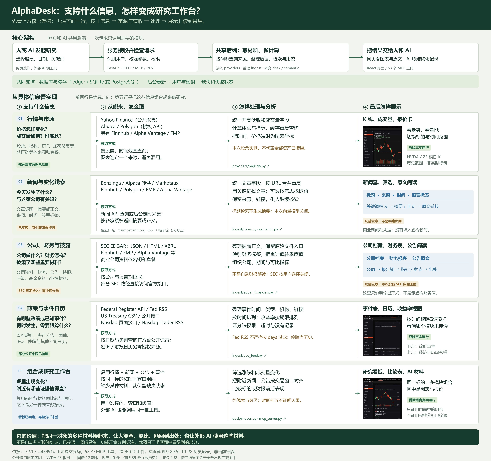
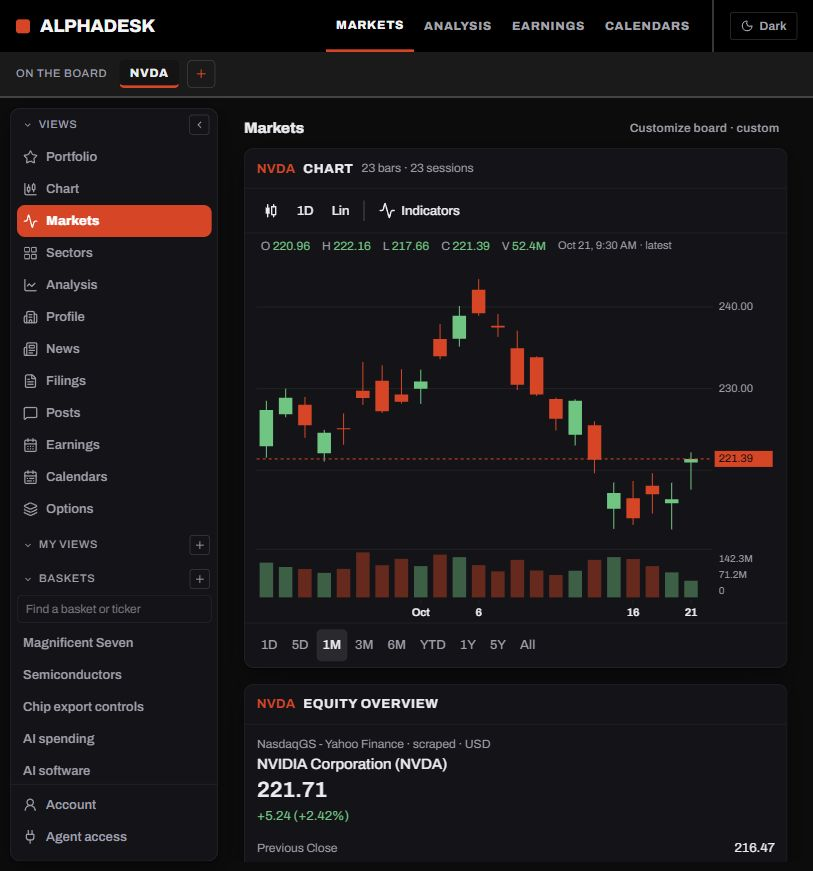
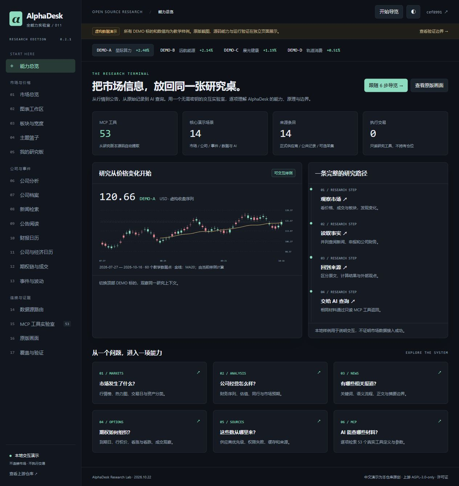
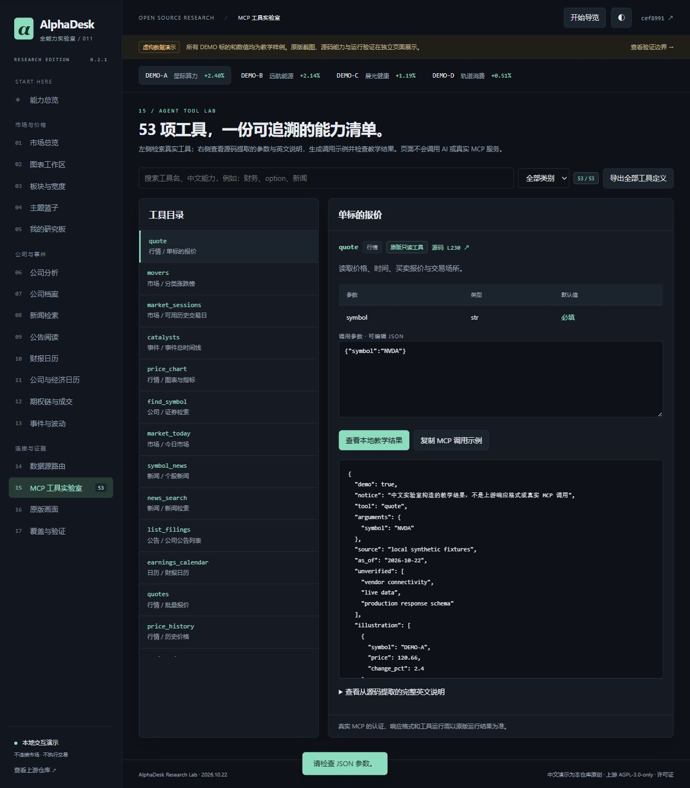
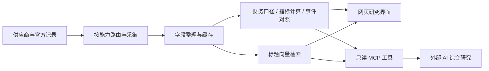
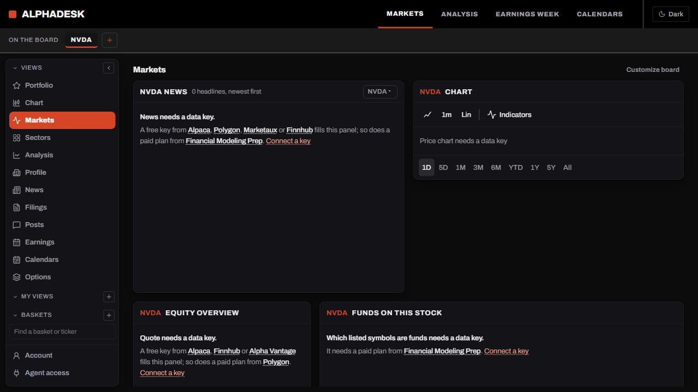

# 011 · AlphaDesk：能力、架构与原理研究专题

AlphaDesk 是一个面向金融研究的数据工作台：从供应商 API、官方记录和公开页面取得行情、新闻、公司披露与事件，经过字段整理、缓存、财务与价格计算、检索，再用图表、阅读器和可组合看板呈现；同一套研究函数也通过只读 MCP / REST 接口供外部 AI 或程序调用。它帮助研究者发现变化、查阅材料和对照证据，不内置自动投资报告、收益预测或交易执行。

**[打开在线研究专题](https://yydshly.github.io/1021_codex_project/projects/011-alphadesk-terminal/) · [放大引导图](https://yydshly.github.io/1021_codex_project/projects/011-alphadesk-terminal/architecture.html) · [进入教学实验室](https://yydshly.github.io/1021_codex_project/projects/011-alphadesk-terminal/lab.html#overview)**

| 理解维度 | 这个库具体提供什么 |
| --- | --- |
| 信息方向 | 市场行情与期权、新闻文章、公司资料与财务、监管披露、政策及市场事件日历；覆盖取决于来源和套餐 |
| 研究场景 | 观察市场与单股、检索每日资讯、阅读财报与公告、对照事件和价格异动、组合个人研究板、向外部 AI 提供研究材料 |
| 使用入口 | 人通过 React 网页使用市场页、图表、阅读器和日历；AI 通过 `/api/agent/tools/mcp` 调用 53 个只读工具；程序也可用 `/api/v1` REST 工具接口 |
| 核心架构 | FastAPI 处理 HTTP / MCP / REST 请求；`providers` 选择与适配来源，`ingest` 整理材料，`ledger` 持久化与缓存，`desk` 组合材料并计算，可选 `semantic` 检索新闻标题；网页用 React / SVG 呈现 |
| 重要原理 | 按能力选源、多源新闻合并与 URL 去重、XBRL 累计值转换季度值、价格与事件时间对照、共享业务函数双端输出；实际请求可直接取源或读缓存，并非每次顺序通过全部模块 |
| 可扩展场景 | A 股研究、每日行业新闻、政策追踪、竞争情报、经营反馈、科研追踪；可借鉴接入契约、研究工作流与人 / AI 双入口，领域数据、规则与分析需另建，尚未实施 |
| 研究价值 | 学习如何把分散信息组织成可核验的研究流程，并用实际数据、失败状态和出处约束分析；是否成为 A 股产品底座仍需迁移验证 |

[](https://yydshly.github.io/1021_codex_project/projects/011-alphadesk-terminal/architecture.html)

**在线内容边界：** Pages 部署的是中文静态研究专题、历史运行截图和使用虚构数据的教学实验室。原版 FastAPI 终端、实时取数及 MCP 服务需在本机独立启动；静态网站不提供在线实盘数据服务。当前已实测若干公开来源，SEC 按用户选择停用，商业源未配置；完整能力目录不等于全部能力已联网验证。

| 项目 | 内容 |
| --- | --- |
| 上游 | [vigneshv1cky/alphadesk-terminal](https://github.com/vigneshv1cky/alphadesk-terminal) |
| 研究版本 | 0.2.1 · `cef8991daa16ab03799f49c56939e48a1d247964` |
| 许可证 | AGPL-3.0-only，见 [全文](UPSTREAM-LICENSE.txt) |
| 日期 | 2026-10-22，Asia/Shanghai |
| 状态 | 研究中：公开真实数据已接通；SEC 暂不接入，商业源未配置 |
| 研究专题 | [在线 Pages](https://yydshly.github.io/1021_codex_project/projects/011-alphadesk-terminal/) · [仓库内静态入口](web/index.html) |
| 教学实验室 | [18 个教学视图](web/lab.html#overview)，使用明确标记的虚构数据 |
| 本机复现 | [研究页 8781](http://127.0.0.1:8781/) · [原版 8782](http://127.0.0.1:8782/markets?symbols=NVDA&symbol=NVDA)，均需先启动本机服务 |

## 先研究能力、架构与原理

[研究专题网页](web/index.html) 已成为默认入口，包含六组能力、七个可点击架构节点、四条原理链路、四组截图、14 个来源条目和 53 个工具的可检索索引。页面直接读取固定版本能力目录与脱敏实测报告，明确区分实测、源码确认和教学样例。六章研究清单可在当前浏览器保存个人进度。

新增 [我们的研究思考](web/index.html#thinking)：七个研究维度逐项对应固定版本实现、思考、边界和验证练习；六个场景比较每日行业新闻、A 股、政策、竞争情报、经营反馈与科研追踪的复用和新增工作，并用每日新闻研究流程贯穿说明。迁移设计明确标为推论，不冒充已经落地的能力。

[信息到研究工作台图](web/architecture.html) 作为网页的主要引导图：上方四个节点解释人 / AI、接口服务、共享研究后端与输出；下方四类信息加一行组合研究，每行对应“支持什么 → 来源与获取 → 处理与分析 → 最终展示”。三张原版历史截图放入行情、事件和看板对应行；未接通的新闻与 SEC 用明确标注的功能示意。提供全图、四栏放大阅读，以及 [高清 PNG](assets/architecture-full.png) 和 [SVG](assets/architecture-full.svg)。

研究结论是：**值得投入一轮有边界的源码研究**，核心价值在于多源契约、数据口径、研究工作流与 HTTP / MCP 双输出的工程设计；是否适合作为 A 股产品底座，仍需通过迁移练习核对规则、数据授权与维护成本。

详细推导见 [源码学习手册](research-guide.md)。网页验证见 [validation-research.json](validation-research.json)。

## 公开真实数据的历史验证与本机复现

在线先看 [历史运行证据](https://yydshly.github.io/1021_codex_project/projects/011-alphadesk-terminal/#running) 与 [接入说明](web/real-data.html)。按下方方法启动本机服务后，可访问 [原版市场看板](http://127.0.0.1:8782/markets?symbols=NVDA&symbol=NVDA)、[图表](http://127.0.0.1:8782/chart?symbols=NVDA&symbol=NVDA) 和 [政府事件与 IPO](http://127.0.0.1:8782/calendars)。以下为 2026-10-22 的历史实测，不是网站实时更新的数据。

| 实际取得的数据 | 来源 | 本次结果 |
| --- | --- | --- |
| NVDA 报价与 1 个月日 K | Yahoo 公开采集 | 23 根日 K，2026-09-21 至 10-21；报价价格字段非空 |
| 国债收益率 | US Treasury 官方 | 12 个期限，曲线日期 2026-10-20 |
| 政府事件 | Federal Register / Federal Reserve 官方 | days=30 查询合计返回 40 条，保留来源 URL |
| 停牌记录 | Nasdaq Trader RSS | 39 条，包含历史未恢复停牌，不等于当日停牌数 |
| IPO 日历 | Nasdaq 公开采集 | 2026-10-19 至 25 周内 2 条 |

这些是原版适配器经网络取得的数据，不是生成的 fixtures。报价、政府事件、停牌另经真实 MCP tools/call 读取成功；临时令牌已撤销。报告见 [validation-public.json](validation-public.json)，完整响应仅保存在忽略的 `.runtime/public/`。

Yahoo 是公开采集而非交易所实时数据；上游报价响应没有明确成交时间，不能把请求时间当作成交时间。图表接口未附来源，通过 `/api/chart/capabilities` 确认当前使用 yahoo。政府 feed 的 Fed RSS 按条数返回，days 参数不对其强制时间过滤。

按用户明确选择，本阶段不接入 SEC。商业新闻、期权、分析师数据、完整涨跌榜与经济日历仍需相应凭据。Nasdaq 分红周查询超过 45 秒；拆股未取得记录；国债拍卖返回空列表，这三项均不列为已接通。



### 启动真实公开数据模式

```powershell
projects/011-alphadesk-terminal/app/.venv/Scripts/python.exe projects/011-alphadesk-terminal/app/launch_original.py --public
```

使用独立 `app/.runtime/public/` 数据目录，允许公开来源联网，固定关闭 SEC；不载入商业供应商环境凭据，不运行全量后台采集循环。Yahoo / Nasdaq 已在本机数据库开启。新环境可在 Account 开启，也可使用原版 API：

```powershell
Invoke-RestMethod -Method Put -Uri http://127.0.0.1:8782/api/sources/yahoo -ContentType application/json -Body '{}'
Invoke-RestMethod -Method Put -Uri http://127.0.0.1:8782/api/sources/nasdaq -ContentType application/json -Body '{}'
projects/011-alphadesk-terminal/app/.venv/Scripts/python.exe projects/011-alphadesk-terminal/app/verify_public.py
```

Markets 已通过原版的 Customize board 保存为 Chart、Equity overview、Treasury yields 三块布局；其他模块仍可从 Widgets 恢复。配置仅属于当前原版浏览器/账户，不修改上游源码。

## 教学展示从哪里开始

打开 [中文教学实验室](web/lab.html#overview)，点击“开始导览”，依次体验价格图表、公司财务、公告阅读、供应商路由和 MCP 查询。左侧有 18 个页面，MCP 实验室覆盖 **53 个真实工具定义**、参数、调用 JSON 和教学返回值。

“全量”指完整能力目录、原版页面映射和全部工具覆盖，**不表示 53 个工具均已连接真实金融数据**。中文网页是本仓库编写的教学实现，不是上游 UI 的翻译或完整替代。所有 DEMO 公司、新闻、公告、价格和期权都是虚构样例，并持续显示标识。



## 展示范围

| 页面 | 可以体验什么 | 边界 |
| --- | --- | --- |
| 能力总览 | 六步导览、全局标的切换、研究路径 | 教学导航 |
| 市场总览 | 六类资产字段、排序、价格、热力图 | 独立合成样例 |
| 图表工作区 | K 线/折线/面积、时间范围、MA20、RSI、水平参考线 | 自编 SVG；不是上游完整图表引擎 |
| 板块与宽度 | 行业对照、市场宽度 | 虚构统计 |
| 主题篮子 | 预设、自建、本地保存 | 教学 3 个；原版内置 36 个主题 |
| 我的研究板 | 模块开关、排序、刷新保持、JSON 导出 | 浏览器保存，非账户同步 |
| 公司分析 | 财务指标、同行、估值、评级、持股 | 不同证据类型分别说明 |
| 公司档案 | 业务章节、证券资料、基金持仓 | 教学文档 |
| 新闻检索 | 关键词、词表匹配、正文/摘要 | 词表模拟语义流程，未运行向量模型 |
| 公告阅读 | 类型筛选、三页阅读器、复制引用 | 虚构公告，引用带标识 |
| 财报日历 | 预期与实际、披露时间、会议记录说明 | 样例数据 |
| 公司与经济日历 | 类别过滤、事件时间组织 | 样例数据 |
| 期权链与成交 | 到期日切换、看涨/看跌、合约字段 | 合成价格，非定价引擎验证 |
| 事件与波动 | 新闻/公告与价格的时间对照 | 时间邻近不代表因果 |
| 数据源路由 | 14 来源条目、成功/套餐拒绝/未连接 | 路由模拟，不保存密钥 |
| MCP 实验室 | 53 工具、分类搜索、真实参数、JSON 校验与导出 | 教学响应不是上游真实 schema |
| 原版画面 | 六张上游宣传图 | 原作者模糊数字，非本次运行截图 |
| 覆盖与验证 | 20 类原版页面映射、实测记录、运行说明 | 完整列出验证边界 |

完整工具名称、分类、源码行链接、29 条路由声明见 [全量能力索引](capability-map.md)。



## 数据来源与原理

| 来源层 | 入口 | 信息类型 |
| --- | --- | --- |
| 用户凭据供应商 | Alpaca、Polygon、Finnhub、Alpha Vantage、FMP | 行情、公司资料、预期、基金、期权等；按接口/套餐区分覆盖 |
| 新闻适配器 | Alpaca/Benzinga、Benzinga 直连、Polygon、Finnhub、Alpha Vantage、Marketaux、FMP | 标题、摘要或正文、股票标签、来源和时间 |
| 官方公共记录 | SEC EDGAR、US Treasury、Federal Register、Federal Reserve | 申报、财务、内部人交易、收益率、拍卖、规则和公告 |
| 可选采集 | Yahoo Finance、Nasdaq/Nasdaq Trader、trumpstruth.org | 补充行情、日历/停牌、特定账号社交镜像 |

14 是本展示的合并来源条目数，不是独立 API 或独立事实来源数。Alpaca 转供 Benzinga 与 Benzinga 直连可能来自同一新闻源。



原版采用 FastAPI、React/TypeScript、SQLite 或 PostgreSQL。图表主要用自研 SVG；财务读取包含 SEC XBRL 口径处理；语义搜索用本地 Qwen 嵌入模型检索新闻标题。它不内置自动投资报告、买卖评分或交易执行。价值在于缩短“发现变化 → 查阅材料 → 回到出处”的过程，让人和 AI 使用同一套研究材料。

上述实现判断来自固定提交源码；公开来源实测范围见前面的真实数据入口。部分模块直接访问 SEC，供应商抽象并未覆盖所有业务，因此 A 股改造不能只换 API 地址。

## 本地运行

从总仓库根目录执行。中文静态演示只需要 Python 标准库，不需要上游安装或密钥：

```powershell
python projects/011-alphadesk-terminal/app/build.py
python -m http.server 8781 --bind 127.0.0.1 --directory projects/011-alphadesk-terminal/web
```

访问 `http://127.0.0.1:8781/#overview`。静态资源使用相对路径和 hash 路由；线上 Pages 展示相同静态产物。原版后端和本机接口不会随静态网页部署。

架构图的预生成资源已版本化，普通网页构建不需要图片依赖。修改图时运行 `python projects/011-alphadesk-terminal/app/build_architecture.py` 后再运行 `app/build.py`。绘图脚本需要 Pillow 与 Windows 微软雅黑字体；其他系统需调整脚本中的字体路径。SVG 为 2800 × 2630，PNG 为 5600 × 5260，二者由同一组图形定义生成。

原版安装需要 Git、uv 和 Python 3.12，已在 Windows / Python 3.12.13 验证：

```powershell
powershell -File projects/011-alphadesk-terminal/app/setup_original.ps1
projects/011-alphadesk-terminal/app/.venv/Scripts/python.exe projects/011-alphadesk-terminal/app/launch_original.py
```

访问 `http://127.0.0.1:8782/account`。默认独立 `.runtime/` 数据目录，仅监听本机，清除供应商环境凭据，阻止进程的非本机 TCP，关闭后台采集与语义模型。启动器不修改上游源码；这些是研究配置，不是通用安全沙箱。无密钥时原版真实显示缺少来源的提示。

后续在线验证可在自己的终端配置真实 `SEC_USER_AGENT` 联系信息与供应商凭据，再添加 `--online`。该模式恢复上游 dashboard 入口，仍使用本机研究目录，语义模型仍关闭；完整 OAuth/登录与嵌入模型需另行配置。本次没有运行在线模式。

`app/upstream/`、`.venv/`、`.runtime/` 全部忽略，不提交凭据、数据库或依赖。



## 第一阶段离线与教学验证（历史记录）

- 原版 20 个页面壳返回 200，账户接口 200，未认证 MCP 401，无密钥报价/图表接口 428；页面壳成功不证明业务数据成功。
- 运行时注册 53 工具且全部带只读声明；真实 HTTP MCP initialize、tools/list、`data_sources` 和 `baskets` 调用通过；临时令牌撤销后 401。
- 中文演示 18 页导航、53 工具的教学响应、10 项关键交互通过；18 页在 390px CSS iframe 中无页面整体横向溢出，不等于手机硬件/触控验证。
- 商业数据源、SEC 在线采集、实时推送、Qwen 模型与外部 AI/OAuth 完整流程未验证；公开数据的后续实测见本文开头。

记录：[原版](validation-original.json)、[浏览器](validation-browser.json)、[研究笔记](notes.md)。复跑：

```powershell
projects/011-alphadesk-terminal/app/.venv/Scripts/python.exe projects/011-alphadesk-terminal/app/verify_original.py
python -m unittest discover -s tests
python scripts/catalog.py --check
```

## 来源与许可

上游代码、工具英文文档、六张宣传图取自固定提交，保留 AGPL-3.0-only 许可。本项目中文交互实现、构建脚本与合成样例也按 AGPL-3.0-only 提供。图片逐项来源见 [说明](assets/README.md)。代码许可与金融数据转发权限是不同事项。

本次尚未实施 A 股改造；下一阶段可基于能力地图确定研究工作流，再替换证券标识、交易日历、行情/公告/财务和事件来源。
