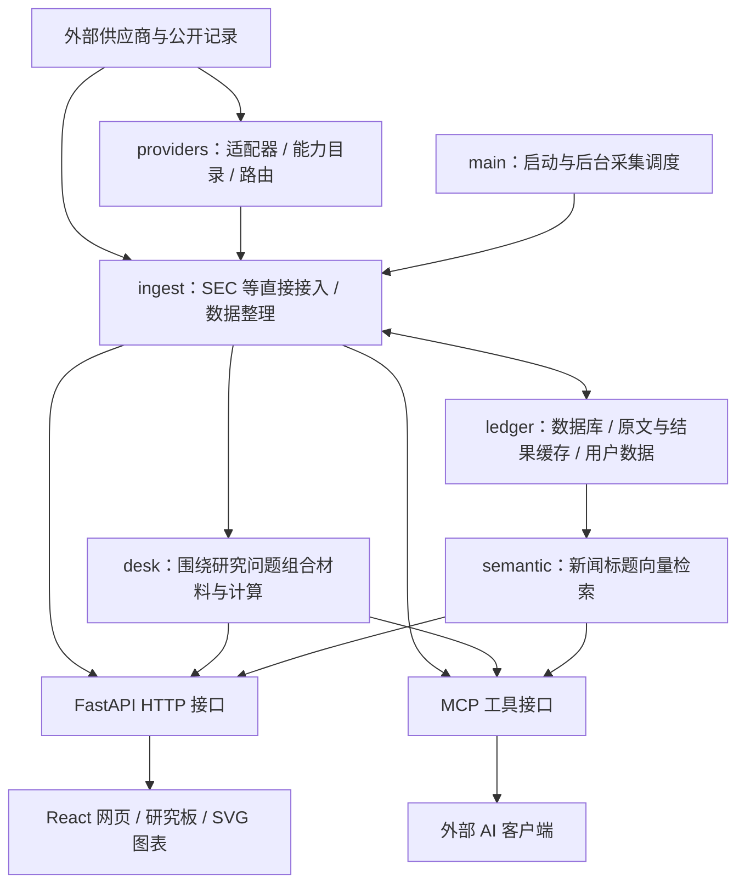

# AlphaDesk 学习手册：能力、架构、原理与迁移思考

研究目标调整为：先解释清楚这个系统为什么这样设计、哪些问题已经解决、哪些只是看起来解决，再讨论我们自己的应用。现阶段不以接满供应商或尽快改成 A 股产品为目标。

研究提交：`cef8991daa16ab03799f49c56939e48a1d247964`，版本 0.2.1，AGPL-3.0-only。以下区分 **源码事实、实测结果、迁移推论**。源码中存在历史注释与当前实现不同步的情况；注释中的性能数字属于上游作者记录，不是本次测量。

## 1. 它到底是什么系统

它是一个围绕证券和事件组织材料的研究终端。输入是外部记录，处理中包含规范化、缓存、检索与确定性计算，输出同时面向网页用户和 AI 客户端。

它提供的是研究材料和部分研究步骤的自动化，不会自动完成投资判断。53 个 MCP 工具也不是 53 个 AI Agent，而是 53 个可调用函数。

| 能力层次 | 具体能力 | 不应混淆的边界 |
| --- | --- | --- |
| 获取事实 | 行情、新闻、申报、财务、日历、期权、持仓 | 注册适配器不等于具备凭据、套餐和稳定连通性 |
| 整理事实 | 字段统一、来源标记、股票标签、时间和用户归属 | 标准化字段不代表不同供应商的统计口径一致 |
| 计算与组织 | 指标、季度财务口径、涨跌与成交量比较、事件时间对照 | 有计算不等于预测；共同发生不等于因果 |
| 检索与阅读 | 关键词、标题向量检索、新闻/公告阅读器 | 搜索相关性不等于重要性；检索不等于摘要生成 |
| 展示与调用 | 研究板、SVG 图表、HTTP API、MCP | 多个输出入口不意味着每处都自动携带全部来源字段 |

已完成的真实数据验证见 [validation-public.json](validation-public.json)。SEC 按用户选择未接入；财务处理原理目前是源码分析，不是在线实测。全部工具与路由清单见 [capability-map.md](capability-map.md)。

## 2. 按职责理解架构

下图是职责归纳，不代表源码已经严格按这些层完全隔离。实际存在直接访问 SEC 的模块，HTTP 与 MCP 也会直接调用共享的 ingest/desk 函数。

| 职责 | 代码入口 | 读代码时要回答的问题 |
| --- | --- | --- |
| 生命周期 | [main.py](app/upstream/alphadesk/main.py) | 哪些数据定时更新？哪些是打开页面才获取？ |
| 供应商契约 | [base.py](app/upstream/alphadesk/providers/base.py)、[registry.py](app/upstream/alphadesk/providers/registry.py)、[catalogue.py](app/upstream/alphadesk/providers/catalogue.py) | “支持一种能力”怎样表达？失败怎样继续或终止？ |
| 新闻整理 | [ingest/news.py](app/upstream/alphadesk/ingest/news.py) | 一篇新闻怎样识别、去重、存储和标注来源？ |
| 财务口径 | [edgar_financials.py](app/upstream/alphadesk/ingest/edgar_financials.py) | 累计值如何转换成季度值？缺失怎样表达？ |
| 研究问题组合 | [desk/moves.py](app/upstream/alphadesk/desk/moves.py)、[desk/pricedin.py](app/upstream/alphadesk/desk/pricedin.py) | 代码实际算了什么？工具名是否比实际输出更强？ |
| 存储与隔离 | [store.py](app/upstream/alphadesk/ledger/store.py)、[db.py](app/upstream/alphadesk/ledger/db.py) | 哪些可共享，哪些必须按用户和供应商隔离？ |
| 意义检索 | [semantic.py](app/upstream/alphadesk/semantic.py) | 模型输入是什么？输出是什么？失败时能否继续？ |
| 网页 API | [dashboard.py](app/upstream/alphadesk/app/dashboard.py) | 路由怎样取得身份、调用业务函数、传递异常？ |
| AI 接口 | [mcp_server.py](app/upstream/alphadesk/mcp_server.py) | 工具怎样复用业务逻辑？权限和输出边界在哪里？ |
| 前端数据刷新 | [queries.ts](app/upstream/alphadesk/ui/src/lib/queries.ts) | 多个组件如何共享请求？刷新周期为何不同？ |
| 新闻与图表 | [NewsPage.tsx](app/upstream/alphadesk/ui/src/pages/NewsPage.tsx)、[ChartCanvas.tsx](app/upstream/alphadesk/ui/src/components/chart/ChartCanvas.tsx) | 大量记录怎样加载、筛选与绘制？ |

上述本地源码链接依赖 README 中的固定版本安装；尚未克隆时可从 [固定提交](https://github.com/vigneshv1cky/alphadesk-terminal/tree/cef8991daa16ab03799f49c56939e48a1d247964/alphadesk) 按相同路径阅读。

身份、会话、供应商密钥加密和 MCP 令牌属于横跨各层的能力，代码位于 `app/auth.py`、`app/agent_oauth.py`、`identity.py`、`ledger/vault.py` 等。它们不是一个“登录页面”就能概括的功能。本次只验证了临时令牌调用与撤销，没有验证完整外部 OAuth 流程。

## 3. 沿着四条真实代码链路研究原理

### 链路 A：一张 NVDA 图表怎样出现

1. 前端把标的、查看范围、每根 K 线周期作为查询条件，通过共享 query key 管理请求与缓存。
2. `/api/chart/{symbol}` 调用路由器，选择提供图表能力的已连接供应商。`vendor_for` 固定供应商，不把不同供应商的分页历史随意拼在一条曲线上。
3. 本次命中 Yahoo 适配器，远端数组被转换成标准 OHLCV 数据；实际周期、覆盖情况等进入返回结构。
4. 前端将时间/价格投影到屏幕坐标，生成 SVG。原版将多根蜡烛批量写入路径，避免每根 K 线产生大量独立 DOM 节点。
5. 范围切换、平移、缩放和绘图依赖前端状态与坐标转换，不是每次都重新获取所有历史。

**实测：** 本次原版取得并绘制 NVDA 月日 K 共 23 根。图表接口本身未附供应商名称，通过 capabilities 接口确认 yahoo；不能因为设计目标强调来源，就假设每个输出字段都已完备。

**迁移推论：** 同一条历史序列需要一致口径，适用于传感器、业务指标和统计报表。自研 SVG 是控制能力与维护成本的取舍，不是所有项目都应照搬。

### 链路 B：每日新闻怎样进入阅读界面

1. 正常后台任务按活跃用户读取其已连接新闻源。代码默认新闻轮询周期为 5 分钟、初始回看 72 小时，可配置；推送源走另外的连接管理。
2. 适配器产生统一文章记录，保留标题、发布时间、来源、正文/摘要、URL 和股票标签等字段。
3. `_merge_feeds` 用规范化 URL 合并同一用户不同来源重复转供的文章，并保留多个 feed 标记。
4. 文章保存后，网页展示最近窗口，继续分页补齐；前端刷新与后端供应商采集是两种不同节奏，刷新网页不保证供应商已经产生新数据。
5. 阅读器使用供应商实际提供的正文或摘要，并提供原文链接。

**边界：** URL 相同可以识别重复转供；同一事件的十家媒体使用十个 URL，不能据此自动聚成一个事件。这是“文章去重”与“事件理解”的区别。新闻标题里的股票标签也不自动建立完整产业链关系。

**实测状态：** 当前公共模式没有商业新闻密钥，也未运行完整新闻后台循环。这条链路已读源码，尚未完成供应商端到端实测。

**迁移推论：** 内容平台首先需要定义身份：一篇文章、一个事件、一家公司、一个版本是不同对象。若目标是每日进展，应增加事件层、版本关系和新增事实比较，而不只是换一个更强的搜索模型。

### 链路 C：向量模型到底做了什么

`semantic.py` 默认使用 Qwen3-Embedding-0.6B，把新闻标题和检索问题转换成向量，用余弦相似度决定补入哪些相关文章。相关结果与关键词结果合并后仍按发布时间排列；相似度用于入选，不用于判断新闻重要性。

它不写新闻摘要、不解释股价、不作推荐。模型不可用时退回词匹配；当前研究模式关闭了模型，中文教学页的词表匹配也不是这套模型。

**迁移推论：** 模型应被放在边界清楚、可以测试的步骤里。“找相关材料”“提取事实”“总结变化”“判断影响”是不同任务，应分别定义输入、证据和失败方式。

### 链路 D：“为什么涨了”怎样被转化成代码

`desk/moves.py` 计算日涨跌、成交量相对参考值，并筛出达到阈值的日期；随后将价格变化前后窗口内的新闻和公告对齐。盘后发布与下一交易时段之间存在时间关系，不能只按日历日期粗暴拼接。

输出是“这一段价格变化附近有哪些材料”，并不是“已证明某条新闻导致上涨”。没有匹配材料时应返回缺失，而不是补一句解释。

类似地，`pricedin.py` 计算历史财报前后的变化、事件前累积涨跌等参照量。工具名叫 priced_in，不代表代码有能力证明市场是否已充分定价。

**迁移推论：** 面对模糊问题，先拆成可计算的证据，再把解释留给人或有约束的 AI。也要检查计算是否适合新用途：例如源码中的整体样本成交量参考值不应未经修改就用于宣称无未来信息的历史回测。

## 4. 真正可举一反三的设计原则

| 观察到的做法 | 可迁移的原则 | 迁移时须补问 |
| --- | --- | --- |
| providers 按能力选择来源 | 业务依赖能力契约，减少与供应商耦合 | 字段名称一致之外，币种、频率、时间、复权和权限是否一致？ |
| 图表固定单一供应商 | 一条连续数据链要保持语义一致 | 切换供应商时，如何让用户发现口径变化？ |
| 不同数据采用不同缓存与刷新周期 | 更新策略由数据变化速度和成本决定 | 缓存失效后是报错、旧值还是部分结果？如何显示新鲜度？ |
| 用户新闻和密钥隔离，部分公共记录共享 | 是否可共享取决于数据性质和授权 | 多租户、删除和撤销权限后，缓存是否一起处理？ |
| HTTP 与 MCP 复用函数 | 一个可信业务核心可服务多个界面 | 身份、过滤条件和错误语义是否真的一致？ |
| 失败与空结果分开 | 没有数据是一种业务状态，不是一个零 | 是没发生、未查询、未授权、超时还是后台正在补齐？ |
| 相关材料与结论分开 | 证据、计算和解释应可区分 | 用户能否看到具体来源与推导过程？ |

这也能迁移到舆情观察、竞争情报、科研文献、产品反馈或经营看板；这些是设计推论，尚未在相应场景中验证。通用的是数据治理与工作流原则，不是美国证券业务规则。

## 5. 学习顺序与完成标准

建议按以下次序逐章研究，每章都产出一张链路图和一个可复现例子：

1. **能力地图：** 说清各输入、输出、用户动作、前置依赖；区分实际存在和本机已验证。
2. **行情纵向链路：** 从按钮一路追到外部请求，再回到 SVG。完成标准是能解释每个转换和缓存位置。
3. **新闻生命周期：** 跟踪采集、URL 去重、用户归属、分页、阅读、保留期限；证明它没有自动做事件聚类。
4. **分析逻辑：** 拆解异动对照与财务累计转季度，给出手算例子和失败边界；不用漂亮页面代替算法核对。
5. **双输出与权限：** 对比同一问题在 HTTP/MCP 的返回，检查来源、时间、缺失及权限；不要只检查 HTTP 200。
6. **迁移练习：** 把同一架构画成“政策/行业资讯研究台”，标出可原样复用、需改契约、需重建领域规则的部分，再估算改造成本。

可以为每项能力使用同一张研究卡：

> 它解决什么问题？输入是什么、来自哪里？中间做了哪些转换或计算？输出是什么？依赖什么权限和数据？如何知道结果新鲜且完整？哪些判断没有做？换到另一个领域，哪些假设会失效？

完成研究的标准不是记住 53 个名字，而是能够独立解释三条以上完整链路，识别一个失败模式，并为新场景画出有依据的改造方案。
