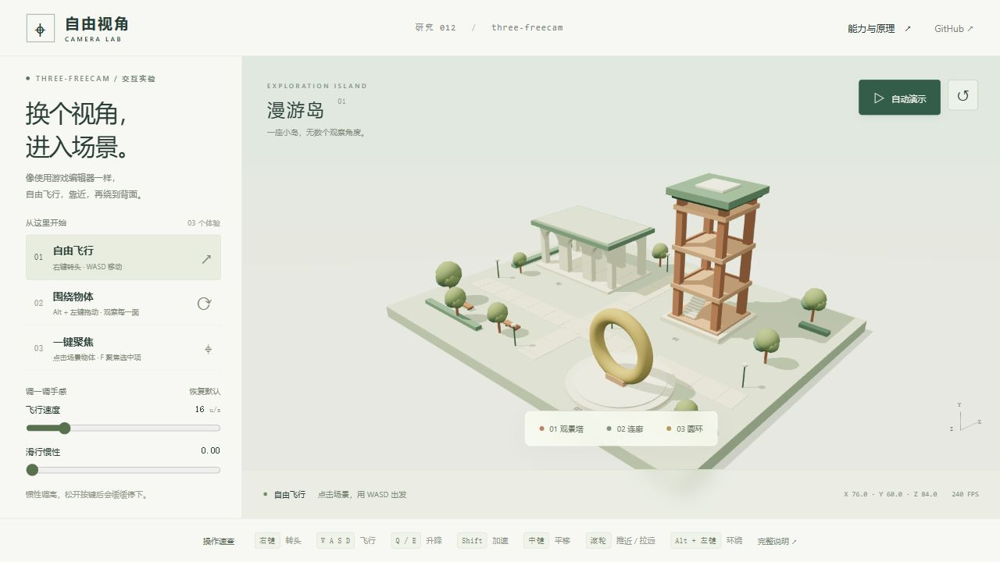

# 012 · three-freecam：基础相机交互封装

研究结论：three-freecam 就是一个 Three.js 基础相机交互封装，提供自由飞行、转头、环绕、平移、推拉与物体取景，能省下重复编写相机控制代码的时间。但对我们当前的研究展示和内容创作需求，价值不大：它没有带来新的建模、渲染或内容生成能力。保留为备用工具，暂不作为重点研究方向；需要三维场景巡检、编辑器视口或自由漫游时再复用。


总结图以本地截图为参考，由内置 imagegen 生成排版；其中的小图是效果示意参考，不替代下方的原始运行截图。生成提示词见 [summary-prompt.txt](assets/summary-prompt.txt)。

交互演示：在原创三维建筑小岛中自由飞行、绕物观察、推近与聚焦。页面使用真正的 three-freecam 驱动相机。

| 项目 | 内容 |
| --- | --- |
| 原仓库 | https://github.com/hxtnv/three-freecam |
| 上游许可证 | MIT，Copyright (c) 2026 Daniel (hxtnv) |
| 使用版本 | npm three-freecam@0.2.0；three@0.186.0 |
| 研究源码 | 6988dee89080c29d7cfbe9abbab879e1fd972996（2026-10-22 核验 main） |
| 状态 | 已完成本轮能力研究与价值评估；保留为备用工具 |
| 静态入口 | [web/index.html](web/index.html)，请通过 HTTP 服务访问 |
| 在线发布 | 本次创建本地演示和静态产物，尚未发布此子项目 |



## 先看效果

从仓库根目录运行：

```powershell
python -m http.server 8012 --bind 127.0.0.1 --directory projects/012-three-freecam/web
```

打开 http://127.0.0.1:8012/ 。预构建资源全部随 web/ 提供，无需 npm 安装、CDN、账号或 API 密钥。

1. 点 **自动演示**：沿 42 秒路径绕岛、靠近建筑、穿过连廊；结束后停止，可暂停或点击场景接管。
2. 点场景激活键盘，用 **WASD** 飞行，**Q/E** 升降，**Shift** 加速，**右键拖动**转头。
3. 点 **观景塔 / 连廊 / 圆环**调用 focus()；**Alt + 左键拖动**围绕当前中心点观察。
4. 单击建筑选中，按 **F** 聚焦；滚轮推近，中键平移。
5. 调节速度和滑行惯性；右键拖动时滚轮调速。点 **回到全景**恢复初始位置。

手机可观看全景、使用预设和自动巡游；不支持触屏自由飞行。窄屏时本页调整视场角与横向取景距离。

## 库能力与演示增强

| 上游 three-freecam | 本演示额外实现 |
| --- | --- |
| 飞行、转头、平移、环绕、推拉 | 原创建筑小岛、灯光、阴影、道路、树木 |
| focus(Object3D) 自动取景 | 射线拾取、选中反馈、F 聚焦选中项 |
| placeAt(position, lookAt) 跳转 | 42 秒自动路径、全景预设 |
| 速度、惯性、按键配置 | 参数面板、位置与帧率显示 |
| window 键盘监听 | 场景焦点门控，避免干扰表单与说明弹窗 |

自动巡游是本页通过 placeAt() 编排的路径，不是库内置路径编辑、缓动或录像功能。原库 F 只处理当前 pivot，本页将其改为聚焦选中物体。

## 开发与构建

已验证环境：Windows、Node.js 22.15.0、npm 10.9.2、Python 3.10.11。

```powershell
cd projects/012-three-freecam/app
npm ci
npm run build
npm run verify:controls
npm start
```

- app/main.js：场景、FreeCam 接入、拾取、预设、巡游和输入管理。
- app/index.html、app/style.css：中文界面、说明和响应式布局。
- app/build.mjs：依赖一起打包至 web/，附完整第三方版权声明。
- app/verify-controls.mjs：向实际 npm 库派发事件，检查 9 项相机行为。
- web/：有意版本化的静态产物，全部资源使用相对路径。
- assets/：浏览器实际运行截图。

修改源码后重新执行 npm run build。页面无服务端、数据持久化或秘密配置。

## 原理与边界

输入维护按键、拖动模式和旋转角；update(dt) 将速度按时间积分到 camera.position，将旋转写入 camera.quaternion。环绕以 pivot 加旋转后的偏移计算位置，取景按包围球和视场角估计距离。Three.js 使用同一个相机渲染。

没有碰撞、重力、触屏飞行和内置录像；可以穿过建筑。focus()/placeAt() 本身直接跳转。不同控制器不能同时争用同一相机。

## 对我们的价值判断

- **代码层面属于基础能力封装**：主要组合输入事件、向量与旋转计算、位移积分和插值。它的价值在于直接复用，不是新的三维渲染技术。
- **通用价值是节省开发时间**：构建三维编辑器、场景巡检和自由漫游工具时，可以少写一套相机操作代码。
- **对我们当前需求价值不大**：研究展示、内容创作和视频制作并不依赖自由飞行相机；单模型展示通常使用 OrbitControls 即可。镜头路径、节奏、动画与导出仍需另行实现。
- **后续投入建议**：留存本次理解、总结图和可运行示例作为工具储备，不继续投入重点研究。该判断限于当前需求，不否定小工具本身的实用性。

## 验证结果

- 浏览器渲染、WASD 移动、连廊拾取后 F 聚焦、自动巡游及暂停已实测。
- 调速滑块方向键可改变参数，相机不误动；390 × 844 窄屏可显示完整岛屿。
- 9 项上游事件级检查通过：飞行、转头、环绕、平移、推拉、调速、聚焦、惯性、禁用。
- 真实鼠标锁定、右拖与 Alt 组合拖动未完成硬件级自动验证；事件级检查不替代该项。
- 详细证据、构建和仓库检查结果见 [notes.md](notes.md)。

## 来源与授权

- [three-freecam](https://github.com/hxtnv/three-freecam)：MIT，通过固定版本 npm 依赖引入，未修改上游实现。
- [Three.js](https://github.com/mrdoob/three.js)：MIT，提供渲染、几何和拾取。
- [官方示例](https://hxtnv.github.io/three-freecam/)：交互能力参考，本页未复制其场景或界面。
- [完整第三方版权声明](web/THIRD-PARTY-NOTICES.txt)随静态产物提供。
- 场景为本项目程序化原创，无外部模型或图片素材。

