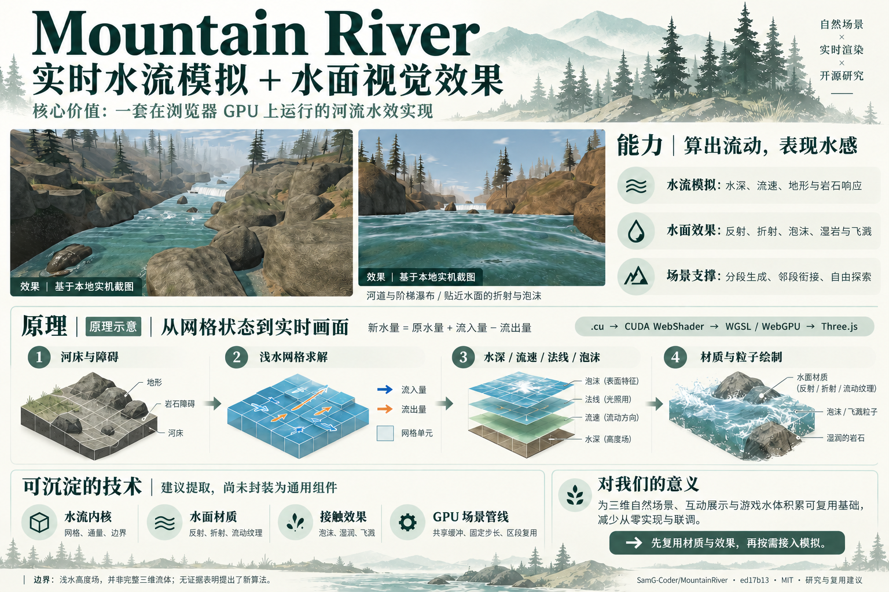

# 013 · Mountain River：实时水流模拟与水面效果

**核心价值是“实时水流模拟 + 水面视觉效果”的完整实现。** 在浏览器 GPU 上实时模拟水深、流速及地形与岩石响应，呈现反射、折射、泡沫、湿岩和飞溅的山间河流水效。可提取浅水求解器、水面材质、接触效果、共享缓冲与分段加载技术，后续用于三维自然场景、互动展陈、游戏浅水水体和水流原理教学；模块封装与跨项目适配尚待实施。

| 项目 | 内容 |
| --- | --- |
| 上游仓库 | https://github.com/SamG-Coder/MountainRIver |
| 研究版本 | `ed17b133ce37f8c97e93262681041d2aded2d8e2`，package version `0.1.0` |
| 研究日期 | 2026-10-22 |
| 上游许可证 | MIT；保留 Techartist、SamG-Coder、CUDA WebShader、Three.js 声明 |
| 状态 | 已完成（能力说明页与本地展示；完整物理回归未复测） |
| 发布入口 | https://yydshly.github.io/1021_codex_project/projects/013-mountain-river/ |
| 本地网页 | [web/index.html](web/index.html)，通过 HTTP 服务访问 |
| 上游在线场景 | https://samg-coder.github.io/MountainRIver/ |



[打开总结图](assets/core-value-summary-v2.png) · [原版河道实机截图](assets/river.png) · [原版水面实机截图](assets/waterline.png)

总结图使用 imagegen 内置工具，以本地实机截图为素材生成；图中原理为示意，复用方向为研究建议。它不是新的原版运行截图；未经生成处理的实际画面见上面的原图。

## 能力与研究结论

1. **计算水怎么流**：二维网格记录水深和水平流速，采用有限体积式通量更新；水位差、阻力和岩石障碍影响流动，泡沫随速度场输运。
2. **表现水怎么看起来**：Three.js WebGPU 读取共享缓冲区，结合折射、菲涅耳反射、深度相关颜色、细波和飞溅粒子呈现水面。
3. **管理河谷怎么延伸**：种子控制地形与岩石布局，区段池准备相邻河段，附近三个区段持续模拟；被回收区段的旧动态状态不保存。

`.cu` 源码通过 CUDA WebShader 转为 WGSL，在浏览器 WebGPU 上执行，并非原生 NVIDIA CUDA。每河段网格为 193 × 441，水流固定步长为 1/120 秒，泡沫等输运场按 30 Hz 更新；这些配置不等于实测帧率。

水流属于浅水高度场。瀑布沿陡峭河床坡面流动，不完整模拟悬空水片、翻卷浪和复杂三维体积流体。跨河段交换不是整个世界的统一严格守恒求解。适合图形技术学习与可视化演示，不应据此认定其达到工程预测精度。

## 核心价值与我们的复用路线

这里的算法价值不止“水流速度”：还包括水深、水位、通量与边界条件。项目沿用已有浅水求解思路，当前研究未发现提出新算法的证据。更值得参考的是把计算结果、材质、粒子和场景调度整合为实时可交互画面的实现方式。

| 可沉淀模块 | 上游入口 | 可复用部分 | 需要适配或验证的内容 |
| --- | --- | --- | --- |
| 水面材质模板 | `src/materials.js` | 深度相关颜色、菲涅耳反射、折射、高光、随流速运动的纹理 | 水深/法线/流速/泡沫、噪声纹理、场景深度与渲染器输入；脱离原求解器后的效果待验证 |
| 水体接触效果 | `src/impacts.cu`、`src/river.cu`、`src/coastal-kernels.cu` | 泡沫生成与输运、湿岩与干燥、飞溅粒子生命周期 | 湿流条件、局部速度、碰撞区域、发射器与粒子状态布局 |
| 浅水求解器 | `src/coastal-kernels.cu`、`src/river.cu`、`src/solver.js` | 网格状态、速度更新、通量限制、水深积分、进出水边界 | 河床/障碍、分辨率/步长与边界条件，并重做稳定性、体积与数值检查 |
| GPU 与场景管线 | `src/solver.js`、`src/scene.js`、`src/sections.js` | 计算/绘制共享缓冲、固定步长、分批初始化、种子生成与区段复用 | WebGPU 设备、缓冲布局、Three.js 接口和目标场景规模；不需要远距离探索时可先用单段 |

**建议顺序：先复用材质与接触效果 → 有地形交互需求再接入浅水模拟 → 长距离场景再引入分段加载。** “优先复用”指提取并适配代码或公式，不代表存在开箱即用的独立组件。

对我们的意义：把一次效果研究沉淀为材质模板、效果组件、求解器接口、参数预设和 GPU 数据契约，预期减少下一次从零实现与联调。适用方向是三维自然场景、互动展示和游戏水体；实际效率与性能收益需在目标项目中验证。

- **已有成果**：固定版本源码、原版运行与截图、能力/原理解读、可复用模块定位和总结图。
- **尚未完成**：模块提取、通用 API 封装、参数预设库、接入我们其他项目后的测试。
- **模型边界**：浅水高度场并非完整三维流体；不据此承诺工程预测精度；复用须保留 MIT 与组件版权声明。

## 后续可扩展的使用场景

以下是基于现有技术的扩展方向，不是本次已交付的功能或已验证的接入结果。

| 使用场景 | 可复用的技术 | 还需要完成什么 |
| --- | --- | --- |
| 三维自然场景、景观预览与互动展陈 | 水面材质、泡沫/湿岩/飞溅、程序化河段与相机探索 | 接入目标地形和美术风格，沉淀参数预设，验证设备兼容性与性能 |
| 游戏中的河流、溪流与浅水环境 | 水深/流速求解、障碍响应、GPU 数据共享 | 对接游戏场景和碰撞系统；若加入可移动障碍，需补充运行时障碍更新；不承诺船只浮力或完整三维流体 |
| 水流原理教学与算法演示 | 网格、通量、水深/流速状态及固定步长 | 新增网格/矢量/通量显示和可控教学参数，用来解释计算过程；不等同于工程水文预测 |

预期意义是减少下一次从零实现水效和连接模拟/渲染的成本；实际复用效率、数值稳定性与帧率需要在目标场景验证。建议先提取材质与接触效果，再按需求引入模拟，最后考虑长距离区段加载。

## 网页内容

- 突出实时水流模拟和水面视觉效果，明确工程支撑与核心能力的关系。
- 一张结合实机截图的信息图，串联效果、能力、原理、可沉淀技术与对我们的意义。
- 四类可复用模块的源码入口、输入依赖、适配事项和建议实施顺序。
- 河道 / 俯瞰 / 水面三种截图与观察提示。
- 点击才加载的原版交互场景；启动状态、失败提示、超时退出与手动卸载。
- 生成河床 → 计算水流 → 绘制水面 → 延伸世界四步讲解和固定版本源码链接。
- 原理剖面图明确标为示意图；上游报告与本机验证分别说明。
- 响应式布局、键盘焦点、图片说明、无 WebGPU 时的截图与说明入口。

## 本地运行

在研究总仓库根目录执行：

```powershell
python projects/013-mountain-river/app/build.py
python -m http.server 8174 --bind 127.0.0.1
```

访问 <http://127.0.0.1:8174/projects/013-mountain-river/web/>。

静态页无需 npm 安装。原版通过本地 `scene/` 加载，源码、编译器和 Three.js 均随项目固定保存，不依赖外部 CDN。需要支持 WebGPU 并开启硬件加速的浏览器，通过 localhost 或 HTTPS 运行。首次编译和准备河段可能需要等待，页面最长等待三分钟后可重试。建议桌面键盘操作，手机优先浏览截图。

直接查看原版：<http://127.0.0.1:8174/projects/013-mountain-river/web/scene/>。WASD 飞行、拖动转头、Q/E 升降、Shift 加速、空格暂停水流、H 隐藏界面。原版界面保留英文。

## 目录与构建

- `app/index.html`、`app/styles.css`、`app/app.js`：说明页源码。
- `app/upstream/`：固定提交的上游源码快照，保留版权、测试脚本与报告，无 Git 元数据和 node_modules。
- `app/build.py`：复制页面、必要静态场景、版权声明、三张实机截图与核心价值总结图到 `web/`。
- `assets/`：原版及研究页的真实截图、基于实机素材生成的总结图与生成提示词。
- `web/`：有意版本化的独立静态产物，适用于现有 GitHub Pages 子路径。

没有修改上游水流算法；中文网页的设计和交互为本研究新增。运行 `build.py` 可重复生成静态文件，不修改上游。

## 验证

- 原版在本机浏览器实际渲染，采集三种视角；截图的 FPS 为当时界面读数，未进行性能基准评估。
- `node projects/013-mountain-river/app/upstream/scripts/check-kernels.mjs`：24 个入口编译为 WGSL，通过。
- `node --check projects/013-mountain-river/app/app.js`：语法检查通过。
- 页面截图选择、原理切换、原版启动/退出与仓库校验：见 [notes.md](notes.md)。
- 上游 `reports/validation.json`、`streaming-performance.json` 仅为作者证据；未复测完整 GPU 物理回归，也未验证全部浏览器兼容性。

## 来源与授权

- [Mountain River 固定版本](https://github.com/SamG-Coder/MountainRIver/tree/ed17b133ce37f8c97e93262681041d2aded2d8e2)：MIT，原声明保留在 `app/upstream/LICENSE` 与 `web/scene/LICENSE`。
- [coastal-simulation / Techartist](https://github.com/iamtechartist/coastal-simulation)：上游水流、光学和 GPU 集成沿用该项目的 CUDA WebShader 移植，归属信息见 `CREDITS.md`。
- [CUDA WebShader](https://github.com/SamG-Coder/cuda-webshader)：MIT；随上游固定 revision `c272bb782f8458761af2894e8771517f64ecdae6`，保留 vendor 下 LICENSE 与 PROVENANCE.md。
- [Three.js](https://github.com/mrdoob/three.js)：上游标注 r185、MIT，保留所带 JS 文件完整许可证头。
- 河流截图来自固定版本本地渲染，不是 AI 生成图片，不把示意图当作上游效果。

## 发布方式

通过研究总仓库的 GitHub Pages 工作流发布 `web/` 静态产物。研究门户与网页继续使用 `assets/core-value-summary-v2.png` 作为引导图；保留原始实机截图作为效果依据。发布结果与验证范围记录在 notes.md。
