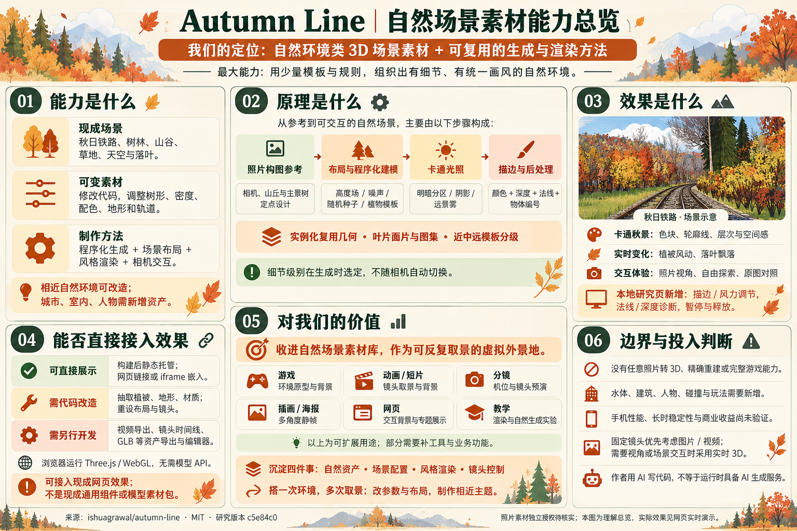
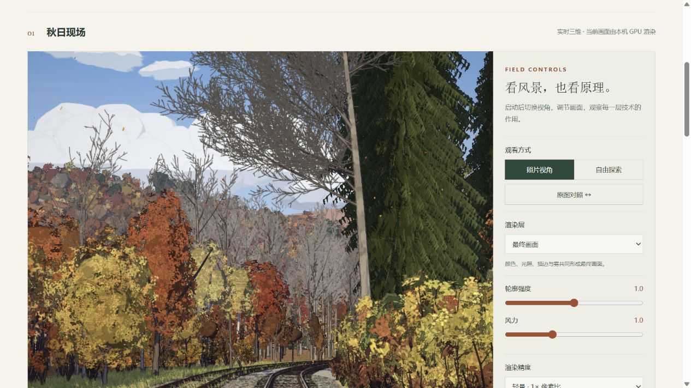

# 015 · Autumn Line：秋日铁路场景与技术沉淀

> 自然环境类 3D 场景素材 + 可复用的生成与渲染方法。用程序化建模与 Three.js 实时呈现铁路、树林和山谷，提供卡通光影、描边、风动、落叶及自由漫游；把环境作为可反复取景的虚拟外景地。

- **能力与效果**：现成秋日铁路场景可通过静态网页或 iframe 接入，支持照片视角、自由探索与原图对照；相近自然主题需修改代码和布局。
- **可沉淀技术**：植物模板与叶片图集、确定性随机与高度场、主景布局与规则散布、实例化绘制、卡通光照与屏幕空间描边，以及场景配置和镜头控制方法。当前仍是源码与研究方法，通用组件需要继续抽离。
- **后续使用场景**：游戏环境原型、动画与短片背景、分镜机位预演、插画与海报静帧、交互网页、图形教学。视频输出、镜头时间线、模型导出和跨引擎材质适配需要另行开发。

| 项目 | 内容 |
| --- | --- |
| 原仓库 | https://github.com/ishuagrawal/autumn-line |
| 上游作者 / 许可证 | Ishu Agrawal / MIT；完整声明保留在 `app/LICENSE`、`web/LICENSE.txt` |
| 研究版本 | `c5e84c0282c5c86ccc595e9d7fa5f5edb040aa26` |
| 研究日期 | 2026-10-22 |
| 状态 | 已完成本阶段研究；通过总仓库 GitHub Pages 工作流发布 |
| 展示入口 | [在线研究网页](https://yydshly.github.io/1021_codex_project/projects/015-autumn-line/) · [本地 web/index.html](web/index.html)，本地须通过 HTTP 服务打开 |
| 上游在线演示 | https://autumn-line.vercel.app/ （本项目运行不依赖该站点） |

## 我们的理解总览



最大能力是用少量模板与规则组织自然环境。现成网页效果可静态托管或 iframe 嵌入；重用植物、地形与画风需要代码改造；视频导出、GLB 等模型导出、编辑器需要另行开发。它不是直接导入任意三维软件的模型资产包，也不提供通用照片重建。

信息图使用内置 image_gen 生成，场景配图是示意；以下截图和网页实时场景用于核对实际效果。[完整生成提示词](assets/natural-scene-overview-prompt.txt) · [详细理解与技术分析](technical-value.md)

## 效果与交互



[完整桌面页面截图](assets/research-desktop.jpg) · [窄屏页面截图](assets/research-mobile.jpg) · [上游原始效果截图](assets/upstream-screenshot.jpg)

- 启动后运行本地打包的上游场景：铁路、地形、森林、天空、草与落叶。
- 照片视角、自由探索、原图分界对照；鼠标拖动转向，滚轮变焦，WASD/方向键移动，Shift 加速。
- 新增最终画面 / 轮廓 / 法线 / 深度四种渲染视图，以及描边强度、风力、像素比控制。
- 新增暂停、恢复默认、释放及重新启动；离开场景可视区域或隐藏网页时跳过场景绘制。
- 展示场景生成耗时与实时帧率。前者不包含网络加载，后者只代表当前环境采样。
- 触屏可拖动观察及对照；未提供触屏移动摇杆。

## 本地运行

直接查看构建产物，在总仓库根目录执行：

```powershell
python -m http.server 8815 --bind 127.0.0.1 --directory projects/015-autumn-line/web
```

浏览器打开 <http://127.0.0.1:8815/>，点击“进入实时场景”。不要直接双击 HTML：ES module 需要 HTTP 服务。

开发与重建：

```powershell
cd projects/015-autumn-line/app
npm ci
npm run dev
# 开发地址：http://127.0.0.1:5215/
npm run build
```

已验证环境：Windows，Node.js 22.15.0，npm 10.9.2，Python 3.10.11；浏览器验证使用 Codex 内置浏览器。锁文件解析 Three.js 0.186.0 / Vite 7.3.6 / TypeScript 5.9.3。构建执行 TypeScript 检查，并输出到 `../web/`。Vite `base: './'` 支持子路径。无需 API key、模型服务或外部字体/CDN。

## 可沉淀的技术价值

| 资产方向 | 源码证据 | 可复用内容 | 迁移边界 |
| --- | --- | --- | --- |
| 卡通风格包 | `app/src/render/toon.ts`、`post.ts` | 明暗分区、配色、雾、按材质描边、诊断视图 | 与双渲染目标、阴影、材质约定耦合，不能直接当独立通用后处理 |
| 自然资产包 | `world/trees.ts`、`builder.ts`、`forest.ts`、`render/leafAtlas.ts` | 植物模板、确定性随机、叶片图集、实例化 | 需抽离物种、密度、位置及色板配置 |
| 场景组织方法 | `core/layout.ts`、`ecology.ts`、`world/track.ts` | 主景定点布置 + 规则散布、轨道空间坐标、高度场 | 布局面向单张照片，不能通过替换图片自动重建 |
| 展示交互外壳 | `controls.ts`、本地新增 `research.ts`、`boot.ts` | 相机模式、参数试验、延迟加载、错误提示、释放重载 | 需补业务热点、键盘/触屏体验与生产监控 |

详细设计、优先级、拟议接口及验收条件见 [技术沉淀分析](technical-value.md)。这里沉淀的是代码与研究方法，目前没有抽出并发布一个通用 npm 包。

## 关键限制

1. 森林 LOD 在生成时按距原点距离分为 `<230 m`、`<700 m` 与更远的模板，**不是随相机移动动态更新的 LOD**；外围散布也偏向照片朝向。
2. 阴影贴图主要在视角变化时更新，风动不会逐帧触发完整阴影更新。这个性能取舍不等于完整动态光照。
3. 原图相机使用约 16.4° 垂直视场角，布局高度针对特定构图；任意角度或走近远景不保证相同质量。
4. 深度诊断使用 `fract(depth / 50)` 周期编码，不是测量工具。将风力调到 0 仅关闭受该 uniform 控制的植被摆动，不等于停止所有落叶运动。
5. 轻量精度只减少像素开销；几何数量、4096² 阴影贴图及双半浮点渲染目标仍有 GPU 成本。未验证手机 GPU、低配设备、Safari 和长时间运行。
6. 暂停冻结时间推进，键盘行走也暂停；参数改变和拖动转向仍可触发静态重绘。没有通用物体碰撞。

## 本次改造

保留上游场景生成算法及美术布局；新增中文研究首页、同源 iframe 参数协议、描边强度 uniform、诊断控制、按需启动与释放、帧率采样、隐藏时停止绘制和启动错误提示。删除外部字体请求；替换上游开发截图写入端点为普通静态构建配置；Three.js 一并打包，不依赖 CDN。保留上游 README 供来源追溯。

## 验证与来源

验证过程及范围见 [notes.md](notes.md)。静态构建含大于 500 kB 的场景 chunk，Vite 会给出体积提示；场景通过用户点击后加载，此提示未被隐藏。

- [固定版本源码](https://github.com/ishuagrawal/autumn-line/tree/c5e84c0282c5c86ccc595e9d7fa5f5edb040aa26)。README 的“一次生成”与 API 费用是作者自述，本研究不验证该开发过程。
- `assets/upstream-screenshot.jpg`、`assets/upstream-reference.jpg` 和 `app/public/reference.webp` 来自同一上游版本。仓库为 MIT，未发现照片另附作者和独立素材授权声明；不能据此推断任意商业图片使用权。
- Three.js 的 MIT 许可证额外保留在 `web/THREE-LICENSE.txt`。
- 发布方式：提交预构建的 `web/`，通过总仓库 `Deploy GitHub Pages` 手动工作流部署；工作流结果与线上访问共同作为发布是否成功的依据。
